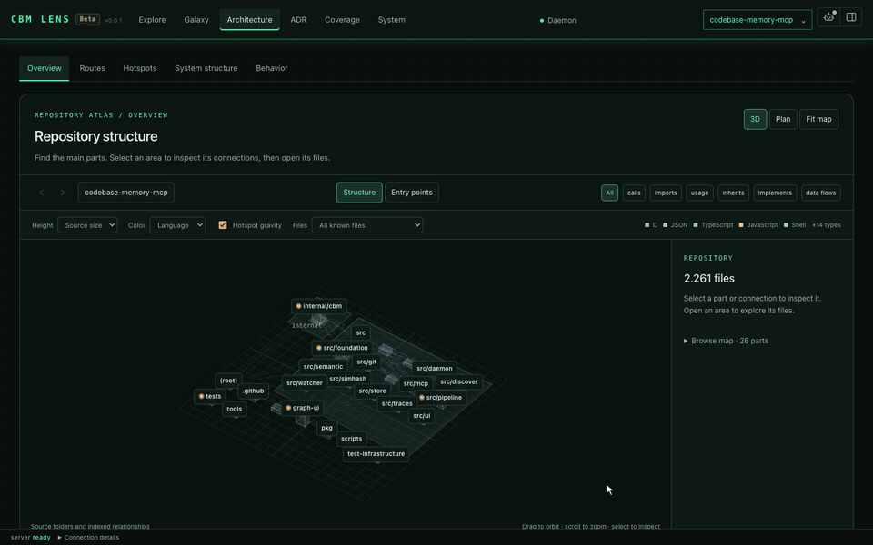
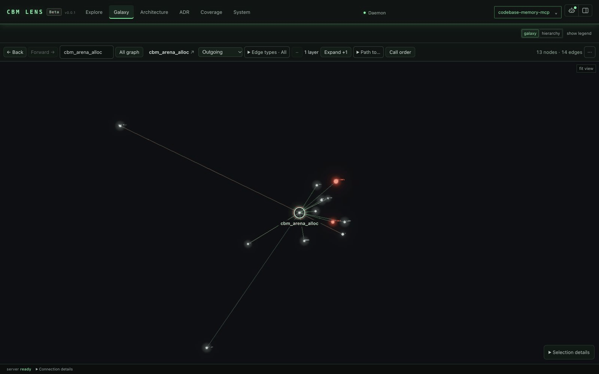
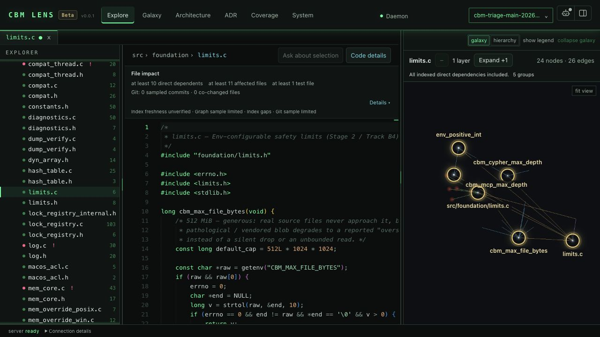
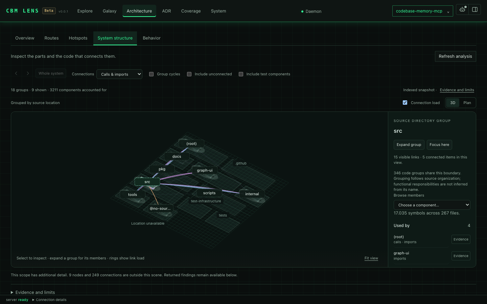
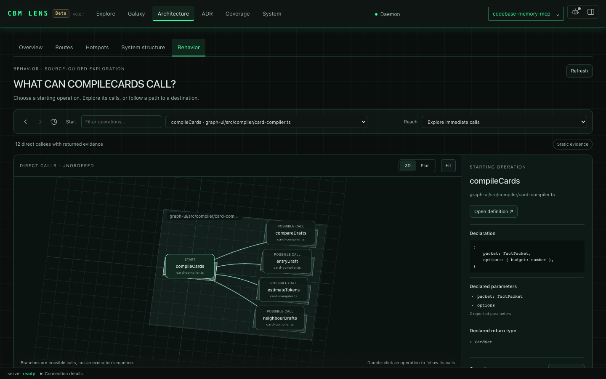
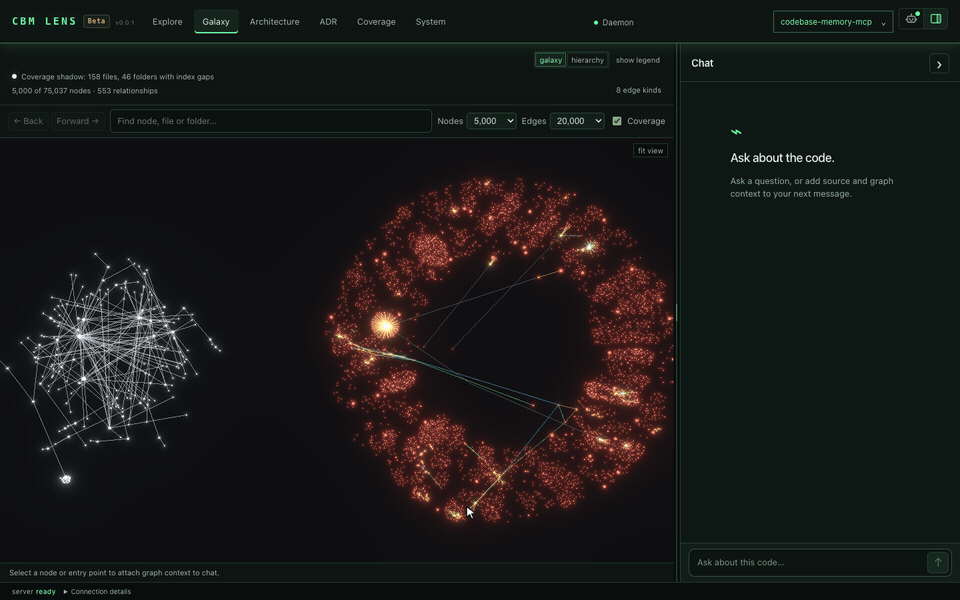

# codebase-memory-mcp: local code intelligence for AI agents via MCP

[](https://github.com/DeusData/codebase-memory-mcp/releases/latest)
[](LICENSE)
[](https://github.com/DeusData/codebase-memory-mcp/actions/workflows/release.yml)
[](#tests)
[](#mcp-tools)
[](https://github.com/DeusData/codebase-memory-mcp)
[](#hybrid-lsp)
[](https://github.com/DeusData/codebase-memory-mcp)
[](https://github.com/DeusData/codebase-memory-mcp)
[](https://github.com/DeusData/codebase-memory-mcp/releases/latest)
[](https://scorecard.dev/viewer/?uri=github.com/DeusData/codebase-memory-mcp)
[](https://slsa.dev)
[](https://github.com/DeusData/codebase-memory-mcp/releases/latest)
[](https://arxiv.org/abs/2603.27277)
[](https://discord.gg/KguGXxg2X)

**Understand your repository, from source code to the systems around it.** codebase-memory-mcp is an MCP server that connects code, documentation, configuration, and infrastructure in a persistent local knowledge graph. Use it to find an unfamiliar feature, follow a call across services, trace a deployment back to its source, or assess which parts of a project a change could affect.

Give your coding agent structural context through [Model Context Protocol](https://modelcontextprotocol.io/) (MCP), or query the graph directly from the CLI. **The MCP server is the core of the project.** Its optional visual companion, **CBM Lens, is in open beta (v0.0.1)**, with a source reader, architecture maps, the Galaxy graph, coverage diagnostics, architecture decisions, and local code chat.

The native C backend exposes **17 MCP tools**, parses [languages and file formats](#language-support) with vendored grammars, and adds [Hybrid LSP](#hybrid-lsp) type resolution for supported languages. The installer supports **45 automatic or conditional client integrations**, including client configuration, skills, agent profiles, and applicable hooks. Indexing and graph queries need no hosted service or API key. Focused graph queries can reduce repeated file reads and token use; see the [measured results](#performance).

[Quick start](#quick-start) · [Capabilities](#features) · [Documentation](#documentation-connected-to-code) · [Infrastructure](#infrastructure-and-deployment) · [Smart CI](#smart-ci-and-test-impact) · [Explore CBM Lens](#cbm-lens-beta-code-visualization-and-source-navigation) · [Agent setup](#agent-setup-skills-profiles-and-hooks) · [MCP tools](#mcp-tools)

> **Local processing:** Source analysis and graph storage run on your machine. CBM Lens can optionally download a model for browser AI after you enable it; inference stays on the device. The installer writes agent configuration for the clients you select. See [Security](#security) for release verification and [SECURITY.md](SECURITY.md) for reporting issues.

**See the graph with CBM Lens (open beta v0.0.1).** Folders become nested platforms, files and symbols become selectable blocks, and arrows show indexed relationships. The recording opens `src/foundation` in the map of this repository, selects `arena.c` and opens its source. Height can show source size; hotspot gravity reflects static fan-in. [Still image](docs/images/lens-architecture.png).

<p align="center">
  
</p>

**Galaxy.** Explore the code knowledge graph in 3D. The recording follows the outgoing relationships of `cbm_arena_alloc` one layer further, switches to the hierarchy and shows the two-hop call path to `cbm_alloc`. Edge pulses show relationship direction; they do not represent live execution. [Still: two dependency layers around `cbm_max_file_bytes`](docs/images/lens-galaxy.jpg).

<p align="center">
  
</p>

**Explore.** Browse files in an IDE-style workspace, read syntax-highlighted source in Monaco, and keep the code graph alongside it. File impact shows what depends on the open file, and Code details shows the callers and calls of the symbol under the caret. Select code to [ask the local chat about it](#chat-with-your-codebase-locally).

<p align="center"></p>

<details>
<summary>More views: system structure and behavior</summary>

<p>System structure groups symbols into components and lets you inspect their dependencies.</p>
<p align="center"></p>

<p>Behavior shows possible calls from a selected operation and the source evidence behind them.</p>
<p align="center"></p>

</details>

The high-resolution GIFs show CBM Lens Beta on 20 October 2026; the still images were captured on 12–13 October. All show public source from this repository. See [capture details](docs/images/README.md) for each capture's build, indexed scope and recording setup.

## Why codebase-memory-mcp

- **Find the right code with context**: combine symbol, text, and semantic search with callers, dependencies, source snippets, and file outlines. Targeted queries and compact, paged results can reduce token use and repeated file reads; see [Performance](#performance) for scoped measurements.
- **Connect documentation to implementation**: index document sections, PDF text pages, architecture decisions, and supported references into code. Find the explanation alongside the symbol.
- **Follow the system beyond source files**: trace supported relationships through Docker, Kubernetes, Helm, Kustomize, Terraform/OpenTofu, Terragrunt, Ansible, scripts, Make, and CI configuration.
- **Understand a change before running it**: inspect affected symbols, compare indexed snapshots, and find related tests. [Experimental Smart CI](#smart-ci-and-test-impact) combines static relationships and per-test coverage for supported C/C++ test harnesses, falling back to broader runs when evidence is insufficient.
- **Explore visually with CBM Lens Beta**: read source, follow call paths, inspect architecture and coverage gaps, manage architecture decisions, and ask a local model about selected code.
- **Equip your coding agents**: `install` sets up supported client configuration, durable guidance, skills, Scout/Verify/Auditor profiles, and applicable context hooks. Support varies by client; see the [integration matrix](#multi-agent-support).
- **Keep context local and reusable**: indexes persist between sessions, eligible active MCP sessions can keep them synchronized, and optional graph artifacts let a team share a baseline.
- **Run a native tool on your machine**: standard releases include CBM Lens for macOS, Linux, and Windows. The native runtime needs no Docker or language runtime; parser grammars are included.

## Quick Start

**Install the latest release** (macOS / Linux):
```bash
curl -fsSL https://raw.githubusercontent.com/DeusData/codebase-memory-mcp/main/install.sh | bash
```

The standard native release includes CBM Lens. Start it after installation with `codebase-memory-mcp daemon start --open --port=9749`. The [Nix packages](#nix-flake) and [source builds](#build-from-source) also offer builds without the UI.

**Windows** (PowerShell):
```powershell
# 1. Download the installer
Invoke-WebRequest -Uri https://raw.githubusercontent.com/DeusData/codebase-memory-mcp/main/install.ps1 -OutFile install.ps1

# 2. (Optional but recommended) Inspect the script
notepad install.ps1

# 3. Unblock the downloaded file (removes Mark-of-the-Web restriction added by browsers/Invoke-WebRequest)
Unblock-File .\install.ps1

# 4. Run it
.\install.ps1

```

> **Note:** If you see a script execution policy error, run `Set-ExecutionPolicy -Scope Process Bypass` first, or invoke with `PowerShell -ExecutionPolicy Bypass -File .\install.ps1`.

Options: `--skip-config` (binary only, no agent setup), `--dir=<path>` (custom location).

> **Antivirus note:** Microsoft Defender may flag a release binary as
> `Trojan:Script/Wacatac.B!ml`. This is a known false positive; typically 61 of
> ~62 engines return clean, and the same detection family hits `gh`, llama.cpp,
> Godot and Microsoft's own Go toolchain. See
> [Antivirus False Positives](SECURITY.md#antivirus-false-positives) for the
> evidence, how to verify the artifacts yourself, and how to report it if you
> think we are wrong.

Restart your coding agent. Say **"Index this project"**: done.

<details>
<summary>Manual install</summary>

1. **Download** the archive for your platform from the [latest release](https://github.com/DeusData/codebase-memory-mcp/releases/latest):
   - `codebase-memory-mcp-<os>-<arch>.tar.gz` (macOS/Linux) or `.zip` (Windows)

2. **Extract and install** (each archive includes `install.sh` or `install.ps1`):

   macOS / Linux:
   ```bash
   tar xzf codebase-memory-mcp-*.tar.gz
   ./install.sh
   ```

   Windows (PowerShell):
   ```powershell
   Expand-Archive codebase-memory-mcp-windows-amd64.zip -DestinationPath .
   Unblock-File .\install.ps1
   .\install.ps1
   ```

3. **Restart** your coding agent.

The `install` command automatically strips macOS quarantine attributes and ad-hoc signs the binary; no manual `xattr`/`codesign` needed.
</details>

### Agent setup: skills, profiles, and hooks

Installation also equips supported coding agents to use the graph in daily work. The native `install` command detects clients and installs the integration pieces their documented formats support:

| Component | What it adds |
|-----------|--------------|
| **MCP configuration** | Connects the client to the local server and its tools. |
| **Instructions and skills** | Explains graph-first exploration, index freshness, coverage checks, and when to read source. |
| **Scout, Verify, and Auditor profiles** | Offers fast provisional lookup, task-directed verification, or bounded full verification, where custom agents are supported. |
| **Session and compaction hooks** | Restores graph context at supported lifecycle events. |
| **Search and read hooks** | Adds relevant graph context to supported searches and flags recorded coverage gaps after supported file reads. |

Hook augmentation is context-only and fail-open: it does not replace or block the requested tool call. Features vary by client and platform; some clients use durable instructions or a parent-agent handoff instead of hooks or direct subagent MCP access. Codex users review and trust installed hooks through `/hooks`. See [Multi-Agent Support](#multi-agent-support) and [Sessions, compaction, and subagents](#sessions-compaction-and-subagents) for exact support and activation requirements.

### Session Coordination Daemon

CBM automatically shares one per-account coordination daemon across Claude Code, Codex, OpenCode, and every other configured client. There is no opt-in setting for MCP servers or hook clients: the first daemon-backed CBM session starts it, each session registers its own work, and a session-managed daemon stops after the final session. A daemon started with `daemon start` remains running until stopped. The daemon owns long-lived background services such as watchers, shared indexing jobs, and the optional UI. Closing one session cancels work owned only by that session, while work still needed by another session continues.

The detached daemon does not depend on an MCP frontend's stderr. It keeps owner-only durable records under the canonical `${CBM_CACHE_DIR}/logs` directory (default `~/.cache/codebase-memory-mcp/logs`):

| File | Contents |
|------|----------|
| `cbm-daemon.log` | Daemon lifecycle, watcher/indexing, UI, resource, and error events. |
| `daemon-conflicts.ndjson` | Exact-build, coordination-ABI, and cache-root admission conflicts. |
| `activation-events.ndjson` | Install/update/uninstall activation progress and outcomes. |

Thin frontends still write immediate startup and session-specific errors to their own stderr; MCP JSON-RPC stdout remains clean.

All active CBM processes must run the exact same version, executable build, coordination ABI, and canonical cache root. Equivalent `CBM_CACHE_DIR` aliases resolve to the same root; a genuinely different root is rejected while any CBM process is active. MCP servers, hooks, one-shot CLI commands, temporary index workers, and the daemon share a crash-safe OS admission barrier; starting an ordinary conflicting process fails before doing work and records an explicit conflict in `${CBM_CACHE_DIR}/logs/daemon-conflicts.ndjson`.

The native `install` and `uninstall` commands are the deliberate exception to that conflict rule. For installation, download, verification, and private same-filesystem staging finish before activation so a bad candidate never disrupts active work. The native `update` command prints the installer command that performs the update. Activation then publishes account-wide maintenance intent, asks the daemon and every temporary local operation to cancel, and waits to a finite deadline for all coordinated CBM processes to exit. It holds the admission and lifetime barriers exclusively while changing the active binary, configuration, PATH, or indexes. New CBM work cannot enter during this window. Activation progress and results are recorded in `${CBM_CACHE_DIR}/logs/activation-events.ndjson`, and a successful command tells you to restart open coding-agent sessions so they launch the activated build.

Package-manager setup (npm, PyPI, or Go) verifies and caches the native executable for that package. It does not replace the active native installation and therefore does not stop running CBM sessions. When that cached binary is executed, it still enters the same exact-build admission barrier. The shell and PowerShell installers invoke the verified candidate's native `install` command, so they do receive the full account-wide activation guarantee.

The ordinary `cli` mode runs one command locally, but it is not disconnected from the daemon above: it connects to the shared coordination daemon (starting one if none is already running) for that same admission barrier plus per-project locks on graph mutations. Its connection is a `cli_session`: it does not register a project watcher or open a browser, and it holds the admission lease only for the command's lifetime. The shared daemon may serve Lens according to its UI configuration and available assets. If the command's own connection is what started the daemon, that daemon exits again once the command closes and no other session is attached; if a daemon was already running, the command simply joins and leaves it exactly as found. While the command is running, a temporary monitor separately lets activation cancel that operation and its supervised worker safely; the monitor exits with the command and never becomes a standing daemon. See [CLI Mode](#cli-mode) for details.

### CBM Lens Beta: code visualization and source navigation

**CBM Lens is an optional visual companion to the MCP server, currently in open beta (v0.0.1).** Standard native releases include its browser interface, so you can launch Lens directly after installation; UI-enabled source builds include it too. It builds on [CodeAtlasWeb](graph-ui/README.md) by [Bernhard Jackiewicz](https://github.com/BernhardJackiewicz) (design and tracking in #1964). Lens is served on loopback. Browser AI downloads its optional model only after you enable it; inference stays on-device. Each panel names where its facts come from, and what the index did not record is shown as a gap. Start the local server:

```bash
codebase-memory-mcp daemon start --open --port=9749
```

The browser opens at `http://127.0.0.1:9749`. A permanent daemon keeps the UI available after the command exits. Use `daemon status` to inspect it and `daemon stop` when you are finished. For an MCP session, `--ui=true --port=9749` enables the same shared UI. Active clients must use the same executable build and cache directory.

**Open your first repository**

1. Open the project menu and choose **Add project index**. You can also use `Alt+P`.
2. Choose a local repository folder and name the index. Files stay in place.
3. Start indexing and follow its reported status. You can close the dialog while it runs and reopen its activity from the project menu.
4. Open the indexed project. Start with Architecture for an overview or Explore to read a file.

To bookmark a view, use `?project=<name>&workspace=architecture`. Other workspace values are `explore`, `galaxy`, `adr`, `coverage`, and `system`.

| Workspace | What you can do |
|-----------|-----------------|
| **Explore** | Navigate the indexed file tree and read source in Monaco. File impact shows what depends on the open file; Code details shows the callers, calls, references and related tests of the symbol under the caret. |
| **Galaxy** | Search and focus graph nodes, load their neighbors layer by layer, switch to hierarchy, follow a path, and open source. Back and Forward return to earlier views. The coverage shadow marks known gaps around the loaded graph. |
| **Architecture** | Explore the folder map, entry points, routes, hotspots, system structure, and behavior paths. Select a node or connection to inspect its evidence. |
| **ADR** | Read and edit the project's architecture decision record. Save explicitly; the document is stored with the index and shared with `manage_adr`. |
| **Coverage** | Check indexed, partially parsed, skipped, and excluded paths, together with available freshness information. |
| **System** | Inspect daemon activity, indexes, and logs. Filter logs by project, severity, or text. |

**Architecture views**

- **Overview:** move through source folders and files on a 3D map. Choose source-size or uniform height, language or kind colors, and relationship filters. Switch to Entry points to follow a static call graph from a starting symbol.
- **Routes:** switch between the service map and endpoint connections. Deployment metadata and indexed route evidence are shown separately; unresolved registrations remain visible.
- **Hotspots:** inspect symbols using measured signals such as fan-in and complexity. Gravity wells help locate frequently referenced areas. They are not a code-quality score.
- **System structure:** inspect component dependencies, expand groups, isolate cycles, and follow connections back to source evidence.
- **Behavior:** choose a source and a reachable destination to inspect static call paths and their source statements. These paths show possible relationships, not a recorded execution order. Runtime observations require separately ingested traces.

Drag a 3D view to orbit, scroll to zoom, and select a node or edge to inspect it. Edge colors distinguish relationships, and pulses indicate their direction. Reduced-motion preferences pause the pulses. Large views show their limits and omitted counts. A missing edge can reflect an indexing or display limit, so check Coverage and the source before drawing conclusions.

#### Chat with your codebase locally

Open **Chat** with the panel button at the top right to ask about the code you are looking at. In Explore it uses the open file or the exact text you have selected; in Galaxy it uses the selected node and its loaded neighbors. You can also attach graph evidence through **Add context**.

1. Click the robot icon at the top right to open the agent configuration.
2. Choose a local model. The default Qwen2.5 Coder 0.5B downloads about 567 MB; Qwen3 0.6B, LFM2.5 1.2B and Qwen3.5 2B are larger options. All need WebGPU with `shader-f16` support.
3. Click **Download & load**. Model files come from Hugging Face; inference runs in your browser, with no hosted chat API or API key. A model that is already in the browser cache loads with **Load model (cached, no download)**.
4. Ask a question. The composer shows the file or selection that will accompany it. Select a smaller range when you want to focus the answer.

Questions about callers and callees, such as "Who calls cbm_pipeline_run?", are answered from the loaded graph without the model, and the answer says so. When you select a symbol, the chat lists its indexed facts and the lines of its code, and the model adds one sentence; that sentence is left out when it claims something the source does not show. Text written by the model is labelled as such.

The recording asks who calls `arena_grow` and what it calls, with both answers listed directly from the indexed graph beside the selected symbol. [Still image of a model explanation and graph answer](docs/images/lens-chat.png).

<p align="center"></p>

The chat history is kept for 24 hours in this browser, per project. Each new message uses the source currently open in the reader; earlier source snapshots are not silently accumulated, and messages about another file or selection are not sent along. If a prompt is too long for the model, older messages are left out first; if it still does not fit, CBM Lens asks you to select less code instead of cutting the code. This chat explains the context you give it; it cannot edit files or run tools. Check its answers against the source. The small default model words things loosely, especially in languages other than English.

#### Search

`Cmd+K` or `Ctrl+K` opens the Galaxy search. It finds symbols, files and folders by name or path in the whole index, also nodes that are not loaded yet. For callers and callees, ask in the chat; the answer is listed from the graph.

**Architecture decisions**

The ADR workspace keeps an unsaved draft per project in this browser tab. It checks whether the stored document changed before saving, but the API does not provide an atomic document lock. The editor accepts up to 8,000 UTF-8 bytes. Saving changes the indexed decision document, not a file in your repository.

<details>
<summary>Experimental agent activity</summary>

The Agents workspace and activity overlays are hidden in normal builds. To include them in a source build:

```bash
VITE_EXPERIMENTAL_AGENTS=true scripts/build.sh --with-ui
```

Activity comes from explicitly configured tool hooks. The bundled adapter supports Claude Code PostToolUse; other clients need their own adapter. Recorded events go to the local daemon, and the reader must enable activity before the browser polls them. This does not automatically observe every agent. See the [frontend setup guide](graph-ui/README.md#experimental-agent-activity).

</details>

For troubleshooting, open System logs. Frontend errors and failed requests are recorded locally. `GET /api/ui-log` reads frontend entries from the daemon's SQLite journal; `${CBM_CACHE_DIR}/logs/ui.log` is also retained as a rotating JSONL export. See the [frontend README](graph-ui/README.md) for log scope, model setup, and development details.

### Auto-Index

Enable automatic indexing on MCP session start:

```bash
codebase-memory-mcp config set auto_index true
```

`auto_index` is off by default. When enabled, new projects are indexed automatically on first connection. The configurable file limit is `config set auto_index_limit 50000`. Previously indexed projects can be watched independently through `auto_watch` (on by default), subject to the session rules below.

The watcher follows MCP sessions: it watches the project each open MCP session is rooted in (the client's working directory) and stops when the last session for that project closes. A repository indexed with `cli index_repository`, or indexed from a session rooted somewhere else, is not watched; re-run `index_repository` after changing it. `index_status` reports this in its `watch` object: `watched`, and either the poll cadence and last scan time or the `reason` it is not watched.

Watcher registration is controlled separately by `auto_watch` (default `true`). Set `config set auto_watch false` to keep a session from registering its project with the background watcher; useful when working across many projects and you want each session contained to explicit indexing.

To turn the watcher off entirely, set `config set watcher_enabled false` (default `true`): the background poll thread never starts and no project is registered, while `auto_index` and manual `index_repository` keep working. Unlike `auto_watch`, which is consulted per session, `watcher_enabled` is read once when the background daemon starts, so run `codebase-memory-mcp daemon stop` after changing it; reconnecting your MCP client alone will not restart the daemon. See [docs/CONFIGURATION.md](docs/CONFIGURATION.md#2-cli-managed-runtime-settings).

The watcher follows **git** projects only by default: a project indexed from a directory that is not a git repository is not watched and stays at its last index until you run `index_repository` again. To have such roots polled too, set `config set watch_non_git true` (default `false`, read when the daemon starts): they are then checked on the same cadence with a file-tree scan that uses the indexer's own ignore rules.

### Keeping Up to Date

**Updates run from the install script on every platform, not from inside the running binary.** `codebase-memory-mcp update` validates your flags and then prints the exact command to run:

```bash
# macOS / Linux
bash "<install-dir>/install.sh"
```

```powershell
# Windows
powershell -File "<install-dir>\install.ps1"
```

The install script is placed next to the binary at install time, so the printed path resolves beside the executable. It is idempotent, so re-running it *is* the update: it stops the daemon, retires the running binary, installs the new one, and cleans up.

Why it works this way. On Windows it is a hard requirement; a running executable cannot replace its own image, so the swap has to happen from a process that is not the binary being replaced. On macOS and Linux it is a deliberate choice: an in-process updater is structurally a downloader (fetch an archive, verify it, unpack it, mark a file executable, run it), and shipping that composite in every binary to serve a command most people run a handful of times is a poor trade. The release archives now carry no download URLs at all, and **cbm makes no network request of its own accord**: it does not check for new versions in the background, and nothing phones home. You find out about releases from the install script, your package manager, or GitHub.

If PowerShell refuses to run the script because the file came from the internet, `Unblock-File` it first.

Installed through **npm or pip**? Update with your package manager on every platform (`npm install -g codebase-memory-mcp@latest` / `pip install -U codebase-memory-mcp`).

### Uninstall

```bash
codebase-memory-mcp uninstall
```

Removes owned agent config entries, skills, hooks, instructions, and the installed binary. Existing graph indexes are listed and **kept by default**. `-y`/`--yes`, `-n`/`--no`, and noninteractive input keep them unless `--delete-indexes` is explicitly given. An interactive terminal without that flag is asked separately; the default answer is to keep them.

```bash
codebase-memory-mcp uninstall -y --delete-indexes   # also delete every project index
codebase-memory-mcp uninstall --dry-run --delete-indexes   # preview; change nothing
```

`--delete-indexes` is explicit consent and takes precedence over `--no`; `--dry-run` always preserves the files. When indexes are kept, uninstall prints their cache directory (`${CBM_CACHE_DIR:-~/.cache/codebase-memory-mcp}`) and how to remove them.

The install script placed beside the binary is **reported, not deleted**: uninstall prints its path and the `rm` command for it. It is left alone on purpose: it may be your own copy, a symlink into a checkout, or managed by a package manager, and an uninstaller should not delete a file it cannot prove it owns.

## Features

### Graph & analysis
- **Architecture overview**: `get_architecture` returns a compact summary by default. Request specific `aspects` for routes, hotspots, dependencies, clusters, or cycles. `system_structure` provides the projection used by CBM Lens and must be requested on its own.
- **Architecture Decision Records**: `manage_adr` persists the project's decision record across sessions; indexing also extracts supported ADR metadata and supersession from documentation files
- **Louvain community detection**: Discovers functional modules by clustering call edges
- **Change impact**: `detect_changes` maps uncommitted changes to affected symbols with risk classification and can report test impact with `scope: "tests"`; `compare_graphs` compares indexed snapshots
- **Runtime observations**: `ingest_traces` adds observed call relationships from separately collected traces alongside static analysis; static call paths alone do not show what ran
- **Call graph**: Resolves function calls across files and packages (import-aware, type-inferred)
- **Dead code candidates**: find functions with no indexed callers, excluding entry points. Check dynamic dispatch, coverage gaps, and framework conventions before removing code.
- **Cypher-like queries**: `MATCH (f:Function)-[:CALLS]->(g) WHERE f.name = 'main' RETURN g.name`

### Search
- **Semantic search** (the `semantic_query` parameter of `search_graph`, not a separate tool): vector search across the entire graph, powered by bundled Nomic `nomic-embed-code` embeddings (40K tokens, 768d int8) compiled into the binary; no API key, no Ollama, no Docker. 11-signal combined scoring (TF-IDF, RRI, API/Type/Decorator signatures, AST profiles, data flow, Halstead-lite, MinHash, module proximity, graph diffusion).
- **BM25 full-text search** via SQLite FTS5 with `cbm_camel_split` tokenizer (camelCase / snake_case aware)
- **Structural search** (`search_graph`): regex name patterns, label filters, min/max degree, file scoping
- **Code search** (`search_code`): graph-augmented grep over indexed files only

### Documentation connected to code

Find the explanation behind a symbol and follow supported references back to its implementation. Documentation participates in the graph alongside source files:

- **Markdown, reStructuredText, and AsciiDoc** become navigable document sections; **PDFs with text layers** become searchable text pages. PDF extraction does not perform OCR.
- **Document-to-code references** and supported language doc-comment references create `MENTIONS` relationships when the target can be resolved.
- **Architecture decision records** contribute metadata such as status, deciders, and supersession, so decisions can be explored with the code they describe.
- **Supported diagrams and OpenAPI descriptions** contribute structured entities. Extraction and reference resolution differ by format; not every textual mention becomes a graph edge.

Use graph and text search to locate the relevant section, follow its recorded relationships, and open the source evidence. Check `check_index_coverage` before treating a missing result as proof that the repository has no such documentation or reference.

### Infrastructure and deployment

Ask **"What deploys this service?"**, **"Which image runs it?"**, or **"Where does this configuration reach code?"** CBM connects supported infrastructure forms to the source they build, configure, and run:

- **Containers and clusters**: Dockerfiles, Compose services, Kubernetes resources, Helm charts and releases, and Kustomize overlays and patches.
- **Provisioning and configuration**: Terraform/OpenTofu resources and modules, tfvars overrides, Terragrunt dependencies, Ansible tasks and handlers, and supported configuration keys and environment-variable access.
- **Build and delivery**: shell commands, Make targets, and supported CI steps that build images, invoke repository scripts, or deploy resources.

For resolvable inputs, a trace can follow **Service → workload → image → Dockerfile → program**, or follow deployment and configuration relationships. Use `trace_path` modes for topology, deployment, and run paths. These are static relationships from supported source forms; dynamic values and unresolved templates can leave gaps. See [Edge types](#edge-types-selected) for the exact relationship rules and limitations.

### Cross-service linking
- **HTTP** route ↔ call-site matching with confidence scoring
- **gRPC, GraphQL, tRPC** service detection with protobuf Route extraction
- **Channel detection** (`EMITS` / `LISTENS_ON`) for Socket.IO, EventEmitter, and generic pub-sub patterns across 8 languages with constant resolution

### Cross-repo intelligence
- **`CROSS_*` edges** link nodes across multiple repos indexed under the same store
- **Cross-repo architecture summary** combining services, routes, and dependencies across the indexed fleet
- **Run status**: `index_status` (and the UI layout next to `linked_projects`) carries a `cross_repo` object, `{"status":"never_run"}` until `index_repository(mode="cross-repo-intelligence")` has run with that project as the source, then `"ran"` with `last_run_at`, `outcome`, `targets`, `projects_scanned`, `total_cross_edges` and `skipped_projects`. That is how you tell "never linked" apart from "linked, nothing matched". The status is stored in the project's own index next to its `CROSS_*` edges, so a reindex that rebuilds the index drops both at once and the status goes back to `never_run`.
- **Skipped stores**: `target_projects: ["*"]` skips an index built before the #768 schema change rather than failing the whole run. The response lists each one as `skipped_projects: [{"name", "reason": "pre_768_schema", "hint": "reindex this project"}]`.

### Smart CI and test impact

Use the graph to explain which tests a change reaches, and use that evidence to focus supported CI runs. **Smart CI is experimental** and has two layers:

| Layer | What it does | What you supply |
|-------|--------------|-----------------|
| **CI job selection** | Chooses jobs from the changed-file list. | Repository-specific path and job rules; this repository's selector is an example. |
| **Test selection** | Combines static reachability, changed tests, and admitted per-test coverage to select suites or tests. | A supported C/C++ test harness, configuration, a coverage map, and a runner that accepts named selections. |

`codebase-memory-mcp test-impact select` produces a selection with reasons; `test-impact publish` produces the graph-and-coverage bundle used as its baseline. For agent-assisted investigation, `detect_changes` with `scope: "tests"` exposes test impact through MCP.

**Narrowing currently supports C/C++ family code with this repository's test conventions or declared equivalents.** It is not general test selection for every language CBM indexes. Missing, stale, incompatible, or incomplete evidence broadens the selection or returns `run_all`; static reachability without admitted coverage never omits a suite. Begin with report-only shadow mode and validate your harness before enabling gating.

In this repository, test narrowing is wired to the Linux x86_64 test leg when `TEST_IMPACT_MODE=gate`; release and dry-run workflows retain full execution. See the [Smart CI guide](docs/SMART_CI.md) for supported conventions, coverage admission, setup, version requirements, and fallback behavior.

### Edge types (selected)
- `CALLS`: a callable is invoked at the source site
- `CALL_REFERENCE`: a callable is used at a supported reference site (for example, a direct value argument) and resolves to one exact target
- `USAGE`: an identifier is used, but a unique callable target is not proven (including ambiguous or complex expressions)
- `IMPORTS`, `DEFINES`, `IMPLEMENTS`, `INHERITS`
- `HTTP_CALLS`, `ASYNC_CALLS` (cross-service); a shell script, Make recipe or CI step running `curl` / `wget` on a URL it states (constant words resolved, unknown parts `{}`) to its `Route` with the method its flags give: a Kubernetes Service of the repository by the path, as code clients do, any other host (a download, localhost) with the host kept; the edge keeps `via`, `method`, `url_path`, `host`, never the user info or the query
- `SPAWNS`: the caller starts another program (`subprocess.run`, `exec.Command`, `posix_spawn`, `Process.Start`, a shell command or Make recipe running a program by path, ...); the target is a `Process` node named after the program, or `<dynamic>` when the program is not a literal. When a shell script, Make recipe, GitHub Actions step or Prow job runs a script of the repository (`./hack/x.sh`, `bash hack/x.sh`), the target is that script's `Module` (else its `File`); `make TARGET` (also `$(MAKE)`, `-C`, `-f`) targets the rule of that target, followed through included makefiles; edges from CI carry `ci` and `job`. A Dockerfile's last stage `ENTRYPOINT` (else `CMD`) spawns what the container runs (`api: dockerfile`): the repository script or source copied into the image, the Go `main` of a binary a stage builds with `go build -o`, else a `Process`
- `INFRA_MAPS`: a Kubernetes Service to each workload whose pod labels carry every `key: value` of the Service's selector, within one namespace
- `CONNECTS_TO`: a Kubernetes workload or compose service to the Service its containers' environment addresses (`PRODUCT_CATALOG_SERVICE_ADDR: productcatalogservice:3550`, a URL's host, `<svc>.<ns>.svc...`, a bare name on an `*_ADDR` / `*_HOST` / `*_URL` / ... key; compose: the project's `.env` interpolated): a Kubernetes Service of the same bundle and namespace, or a compose service of the same file. The edge keeps `via: env`, `key` and `container`, never the value
- `USAGE` with `ref: image`: a Kubernetes workload (any pod template: containers, initContainers, CronJobs, custom resources) or a docker compose service to the `Image` it runs
- Helm templates are rendered for their images: with the chart's values (the `Chart` `DEPLOYS` them, `default_of`: the values keys read) and with each release's (a Flux HelmRelease, a kustomize `helmCharts` entry, a Terraform `helm_release`: `override_of`). An image the render cannot know is left out, never guessed: after a change of values it does not run exactly, a `tpl` or include it cannot look into, a release value it cannot read, or a work budget it runs past. Known limit: each template file renders on its own, while Helm renders a chart's files with one shared `.Values` (a subchart's is its parent's `.Values.<alias>`), so a chart that changes `.Values` in one file and reads it in another can still show a wrong image
- `DEPLOYS`: what puts manifests, kustomizations or charts on a cluster, to what it puts there: a Flux Kustomization or Argo Application to the kustomizations / manifests / chart of its path, a Flux HelmRelease to its chart (`spec.chart` or `chartRef` → OCIRepository), a shell command or Make recipe (`kubectl apply -f/-k`, `kustomize build | kubectl apply`, `helm install/upgrade/template`), a Go installer loading a chart with the Helm SDK, a Terraform `helm_release`, a Terraform `kubernetes_*` resource the object it declares (a `Resource` like a manifest's, `ecosystem: terraform`, when its name is a literal), a kustomization inflating a chart (`helmCharts`; its values file an `IMPORTS`). A chart outside the repository is an external `Chart`, keyed by its publisher when its repository URL is stated (`__chart__<repository>/<name>`, the same node in every project, the URL in `repository`), else one per project and name; the edge says `via` (`flux`, `argo`, `helmrelease`, `kubectl`, `kustomize`, `helm`, `helm-sdk`, `terraform`, `helmcharts`, ...)
- `DEPENDS_ON`: a Helm chart to the charts it declares (the local chart for a resolvable `file://` repository, otherwise an external `Chart`; the edge keeps `repository`), and a `go.mod` / `requirements.txt` file to an external `Package`; a Dockerfile to the `Image`s it builds on (`via: from`, `copy-from`); an `Image` to the Dockerfile it is built from (`via: build`; `tool`: `skaffold`, `compose`, `docker-build` for `docker` / `podman` / `nerdctl` / `buildah` build commands in scripts, Make and CI); a compose service to the services its `depends_on` / `links` name
- `CONFIGURES`: code reading an environment variable to the shared `EnvVar` of that name (`strategy: env_access`); a Kubernetes container, compose service or Dockerfile (`ENV` of the image) setting one to that container's own `EnvVar` (`strategy: env_set`, with `source`: `value`, `configMapKeyRef`, `secretKeyRef`, `fieldRef`, ..., `compose`, `dockerfile`; values are never stored); and that container's `EnvVar` to the code reading the name inside the files its image is built from (`strategy: env_read`, with `dockerfile`): the image's files are the sources its Dockerfile's `COPY` / `ADD` put into it, less the context's `.dockerignore`
- `CONFIGURES` with `strategy: key_symbol`: a code symbol to the config key it names (`config_key`). A YAML, JSON, HCL (Terraform, OpenTofu, tfvars), TOML or INI key links by exact name (`maxRetryCount` = `max_retry_count`) and only to code inside the config file's component: its directory, or the one around a `config/`, `configs/`, `conf/`, `settings/` or `etc/` directory. A `.env` or `.properties` key also links by substring (confidence 0.75)
- `OVERRIDE` with `via: patch`: a Kustomize patch to each object of its kustomization's build it changes (child → base): a patch file's documents to the object of the same kind and name; an inline patch (from the kustomization) or a JSON6902 operation file to what its `target` selects (group, version, kind, name, namespace, label selector); a component's in the build of each kustomization including it. The edge keeps `kustomization`, `patch` and `line`; a patch file is an `IMPORTS` (`local_name: patches`) of its kustomization, never a member of the build
- `OVERRIDE` with `via: namePrefix` / `nameSuffix`: an object a kustomization renames, from its variant: a `Resource` named with the deployed name (`capi-` + `controller-manager`; the prefixes of nested kustomizations outermost first, suffixes innermost first) in the namespace that build gives it, `ecosystem: kustomize`, which the kustomization's file `DEFINES`. CRDs, Namespaces and API services keep their names, as kustomize does. The edge keeps `kustomization` and `line`
- `USAGE` with `via: terraform`: a Terraform / OpenTofu reference (`var.X`, `local.X`, `module.X`, `data.T.N`, `T.N`) from the top-level block holding it to the block of its module (the `.tf` / `.tofu` files of its directory) that declares it (a `locals` entry: its `locals` block); an entry of the block's `depends_on` list is a `DEPENDS_ON` instead. The edge keeps `ref` (`var`, `local`, `module`, `data`, `resource`) and `line`; a name only mentioned in string text is no reference. A module call with a local source (`module "net" { source = "./modules/net" }`) `IMPORTS` (`local_name`: the module's name) the `Folder` of that directory (the root directory: the `Project`), and `module.net.id` (also `module.net[0].id`, `module.net[*].id`) `USAGE`s (`ref: output`) the `output "id"` there, beside `module.net`
- `OVERRIDE` with `via: tfvars`: a `.tfvars` assignment to a variable the module of its own directory declares, from the file's `Variable` to that `variable` block (the edge keeps `line`); a `.tfvars` file whose own directory declares none of its names sets the nearest ancestor module's that does, the edge marked `inferred` (such a file is applied by a `-var-file` the repository does not state)
- Terragrunt (`via: terragrunt`): a unit (`terragrunt.hcl`), evaluated in its own context: an `include` `IMPORTS` (`local_name`) the file its `path` names; a `read_terragrunt_config` `IMPORTS` (`read`: the file holding the call) the file it names, from the block holding the call or, for a call in an included file, from the unit's `include` block that brings it in; a `dependency` `DEPENDS_ON` the other unit; a local `terraform` `source` `IMPORTS` its `Folder`. Paths may use `find_in_parent_folders`, `dirname` and `get_terragrunt_dir`; anything else is unknown and links nothing
- Ansible (`via: ansible`): a playbook or task file (a YAML file whose top level is a sequence) `IMPORTS` (`local_name`: the directive) what its directives name: `import_playbook` a playbook, `include_tasks` / `import_tasks` / `include` a task file (from its directory, else its role's `tasks/`), `roles:` items and `include_role` / `import_role` a role's `Folder` (`roles/<name>` at or above its directory). A templated target links nothing. Each task and handler is a `Function` (named by its `name:`, else its module; `source: ansible`, `kind`, `module`) that its file `DEFINES`: in a playbook's plays, a role's `tasks/` and `handlers/` files, and the files those include; a block's tasks, not the block. A `notify` `CALLS` (`via: notify`) each handler of that name or `listen` topic in the task's own role (else its file). A `kube` (kubespray's module) or `kubernetes.core.k8s` task `DEPLOYS` (`via: ansible`, `module`) the repository file its play rendered the applied manifest from: the `template` (in the role's `templates/`) or `copy` (its `files/`) task whose `dest` is the task's `filename`, item by item through `register` / `with_items` / `loop` lists the play states (a literal list, a `set_fact`, the role's `defaults` / `vars`), or a `k8s` `template:` argument
- `EMITS`, `LISTENS_ON` (channels)
- `DATA_FLOWS` with arg-to-param mapping + field access chains
- `SIMILAR_TO` (MinHash + LSH near-clone detection, Jaccard scored)
- `SEMANTICALLY_RELATED` (vocabulary-mismatch, same-language, score ≥ 0.80)

### Indexing pipeline
- **162 vendored tree-sitter grammars** compiled into the binary
- **Generic package / module resolution**: bare specifiers like `@myorg/pkg`, `github.com/foo/bar`, `use my_crate::foo` resolved via manifest scanning (`package.json`, `go.mod`, `Cargo.toml`, `pyproject.toml`, `composer.json`, `pubspec.yaml`, `pom.xml`, `build.gradle`, `mix.exs`, `*.gemspec`)
- **Infrastructure-as-code indexing**: Dockerfiles (`Dockerfile.*`, `*.Dockerfile`, `Containerfile`: bases, what the container runs, `ENV`), container images (`Image`: the normalised repository, tag and digest on the edges; a repository built from several Dockerfiles, one per component tag, gets an `Image` per component), docker compose services (`Resource`), Kubernetes manifests (`Resource`, with `group`, `version`, `kind`, `namespace`, `labels` as `k=v,k2=v2`), Kustomize overlays (`IMPORTS` to their entries and patch files, `OVERRIDE` from their patches), Helm charts (`Chart`, `DEPENDS_ON`), Terraform / OpenTofu (`.tf`, `.tofu`, `.tfvars`) as graph nodes. A Service walks to the code it runs: Service → workload → `Image` → Dockerfile → `main`
- **[Hybrid LSP semantic type resolution](#hybrid-lsp)** for Python, TypeScript / JavaScript / JSX / TSX, PHP, C#, Go, C, C++, Java, Kotlin, Rust, and Perl; a lightweight C implementation of language type-resolution algorithms, structurally inspired by and compatible with major language servers including tsserver / typescript-go, pyright, gopls, Roslyn, Eclipse JDT, and rust-analyzer (parameter binding, return-type inference, generic substitution, JSX component dispatch, JSDoc inference for plain JS files, namespace + trait + late-static-binding resolution for PHP, file-scoped namespaces + records + LINQ method syntax for C#, class-hierarchy + overload + lambda resolution for Java, extension-function + scope-function resolution for Kotlin, trait-method + UFCS resolution for Rust)
- **RAM-first pipeline**: LZ4 compression, in-memory SQLite, single dump at end. Memory released after.

### Distribution & operation
- **Native runtime set, zero infrastructure services**: SQLite-backed, persists to `~/.cache/codebase-memory-mcp/`
- **Auto-sync**: Background watcher detects file changes in the project an MCP session is working in and re-indexes it automatically (other indexed repos: re-run `index_repository`)
- **Route nodes**: REST endpoints are first-class graph entities
- **CLI mode**: `codebase-memory-mcp cli search_graph --project my-project --name-pattern ".*Handler.*"`
- **Available on**: npm, PyPI, Homebrew, Scoop, AUR, `go install`

### Indexing modes

| Mode | Use it for |
|------|------------|
| `full` | Full indexing with semantic analysis. This is the default. |
| `moderate` | A filtered index with semantic analysis. |
| `fast` | A filtered index without semantic analysis. |
| `cross-repo-intelligence` | Link services across indexed projects, optionally limited by `target_projects`. |

## Team-Shared Graph Artifact

Share a compressed graph snapshot so teammates can reuse an indexed baseline.

`.codebase-memory/graph.db.zst` is a zstd-compressed snapshot of the knowledge graph that lives next to your source. The artifact is opt-in: `index_repository` writes it only with `persistence: true` (the default is `false`), and once it exists later indexes refresh it. Local indexes persist regardless. When a teammate indexes a clone with an existing artifact, CBM imports that baseline and applies their local changes incrementally.

- **Format**: SQLite database, indexes stripped, `VACUUM INTO` compacted, then zstd 1.5.7 compressed (8 to 13:1 ratio typical)
- **Two tiers**:
  - **Best** (`zstd -9` + index strip + `VACUUM INTO`); written by `index_repository` with `persistence: true`
  - **Fast** (`zstd -3`); refreshes an existing artifact on every other index, including the watcher's low-latency incremental updates
- **Bootstrap**: when no local DB exists but the artifact is present, `index_repository` imports the artifact first, then runs incremental indexing, reusing the shared baseline where possible
- **Merge policy**: the first export creates `.codebase-memory/.gitattributes` with `merge=ours`. Check your repository's Git merge-driver setup before relying on it for concurrent artifact updates.
- **Commit it deliberately**: the artifact is rewritten on every index, including the watcher's Fast tier, and git stores each rewrite as a full new blob. Committing every refresh is what turns a 20 MB file into gigabytes of history; one team reached ~6 GB across ~350 commits of this single path. Pick a cadence (a release, a milestone, a nightly job) rather than committing every save.
- **Git LFS, if it must move on every commit**: track it from the **repo-root** `.gitattributes` and leave the auto-created `.codebase-memory/.gitattributes` in place; the nearer file goes on supplying `merge=ours`, and only `filter` comes from the root:
  ```gitattributes
  .codebase-memory/graph.db.zst filter=lfs diff=lfs merge=lfs -text
  ```
  Track only the `.zst`; `artifact.json` is small and carries the schema version. The attribute applies to future commits only. Removing existing blobs requires a separate history migration. Two costs to weigh before adopting it: GitHub meters LFS storage and bandwidth, and its objects cannot be pruned without contacting support; and every teammate needs `git lfs install`; without it their checkout leaves a pointer file where the artifact should be, the integrity-checked import refuses it, and they fall back to a full reindex.
- **Optional**: shared export is opt-in, and Git commits remain your choice. Add `.codebase-memory/` to `.gitignore` if you prefer everyone to reindex from scratch.

The artifact provides a shared baseline while each developer keeps a local query database.

## How It Works

codebase-memory-mcp is a **structural analysis backend**: it builds and queries the knowledge graph. The backend does not require a generative model. It relies on your MCP client (Claude Code, or any MCP-compatible agent) to be the intelligence layer.

```
You: "what calls ProcessOrder?"

Agent calls: trace_path(function_name="ProcessOrder", direction="inbound")

codebase-memory-mcp: executes graph query, returns structured results

Agent: presents the call chain in plain English
```

With MCP, your coding agent translates a question into tool calls. CBM Lens can also use an optional browser model for explanations; this does not change how the backend indexes or queries code.

## Performance

Published backend benchmarks on Apple M3 Pro. These are separate from the CBM Lens checks:

| Operation | Time | Notes |
|-----------|------|-------|
| **Linux kernel full index** | **3 min** | 28M LOC, 75K files → 4.81M nodes, 7.72M edges |
| Linux kernel fast index | 1m 12s | 1.88M nodes |
| Django full index | ~6s | 49K nodes, 196K edges |
| Cypher query | <1ms | Relationship traversal |
| Name search (regex) | <10ms | SQL LIKE pre-filtering |
| Dead code detection | ~150ms | Full graph scan with degree filtering |
| Trace call path (depth=5) | <10ms | BFS traversal |

**Memory-aware pipeline**: Indexing keeps hot data in memory and can spill extraction results to disk when needed. Memory is released back to the OS after indexing completes.

**More focused context, fewer tokens**: The project's [31-repository preprint](https://arxiv.org/html/2603.27277v1#S4.SS1) reports **10× lower token use** and **2.1× fewer tool calls** compared with file-by-file exploration. These March 2026 backend measurements cover the study's workloads and agent setup; the paper documents the full evaluation. An earlier [five-query comparison](https://github.com/DeusData/codebase-memory-mcp/blob/4ff6feeab639c4668da0f491930326ed5ec63093/README.md#performance) reported ~3,400 versus ~412,000 tokens for structural queries. The study's [system-performance measurements](https://arxiv.org/html/2603.27277v1#S4.SS3) include the Linux indexing and Cypher timings above.

Explore the [measurement guide](docs/MEASURING_SAVINGS.md) to evaluate quality, latency and token use on your own workload.

## Troubleshooting & Diagnostics

codebase-memory-mcp **indexes and queries locally and collects no telemetry**. When you hit something we can't reproduce on our side (a slow memory climb over hours, a performance regression, a leak that only appears after days of real use), **we have no diagnostic data unless you choose to send it.** Here is how to capture it yourself.

### Capture a diagnostics log

Set `CBM_DIAGNOSTICS=1` before the first daemon-backed MCP session starts, then reproduce the problem (let it run as long as it takes; a slow leak needs time to show in the trend). The shared daemon captures this setting from the session that starts it. If it is already running, close all daemon-backed sessions so it exits before changing the setting. The daemon creates a fresh owner-private `cbm-diagnostics-<pid>-<random>` directory below the system temp directory (`$TMPDIR` or `/tmp` on macOS/Linux, `%TEMP%` on Windows). The exact paths are recorded by the `diagnostics.start` event in `${CBM_CACHE_DIR}/logs/cbm-daemon.log`:

| File | What it is |
|------|------------|
| `trajectory.ndjson` | **The memory trajectory**: one JSON line every 5 s with `rss`, `committed` (Windows commit charge), `peak_*`, `page_faults`, `fd`, and `queries`. **This is the file we need for memory/leak reports**: the *trend over time* is what pinpoints a leak. It is **kept on disk after the server exits** (so you can grab it post-mortem) and rotates to `trajectory.ndjson.1` past ~8 MB. |
| `snapshot.json` | The latest snapshot only; handy for a quick live check. Removed on clean exit. |

The private randomized directory prevents another local account from pre-placing a link or special file at a predictable diagnostics path. Its `<pid>` component is the shared daemon's process ID, also recorded by the `daemon.start` event. Set the variable consistently in the `env` block of each agent's MCP server config, or export it before launching the first session.

### What to share

When you open a memory/performance issue, **attach the `.ndjson` trajectory**: it contains no source code or query text, only resource counters. If you'd rather not attach a file, paste it (or an agent's summary of it) into the issue: your assistant can read the NDJSON directly and report whether `rss`/`committed` grow monotonically, how fast, and relative to query count; which is exactly what we need to find the cause.

## Installation

### Pre-built Binaries

| Platform | Archive |
|----------|---------|
| macOS (Apple Silicon) | `codebase-memory-mcp-darwin-arm64.tar.gz` |
| macOS (Intel) | `codebase-memory-mcp-darwin-amd64.tar.gz` |
| Linux (x86_64) | `codebase-memory-mcp-linux-amd64.tar.gz` |
| Linux (ARM64) | `codebase-memory-mcp-linux-arm64.tar.gz` |
| Windows (x86_64) | `codebase-memory-mcp-windows-amd64.zip` |

Every release includes `checksums.txt` with SHA-256 hashes. The executable is self-contained; no adjacent data file is required. Linux `-portable` archives contain the fully static builds; ordinary platform archives use their native system ABI.

> **Windows note**: SmartScreen may show a warning for unsigned software. Click **"More info"** → **"Run anyway"**. Verify integrity with `checksums.txt`.

### Setup Scripts

<details>
<summary>Automated download + install</summary>

**macOS / Linux:**

```bash
curl -fsSL https://raw.githubusercontent.com/DeusData/codebase-memory-mcp/main/scripts/setup.sh | bash
```

**Windows (PowerShell):**

```powershell
irm https://raw.githubusercontent.com/DeusData/codebase-memory-mcp/main/scripts/setup-windows.ps1 | iex
```

</details>

### AUR (Arch Linux)

```bash
yay -S codebase-memory-mcp-bin
```

```bash
paru -S codebase-memory-mcp-bin
```

The `codebase-memory-mcp-bin` package is available at: https://aur.archlinux.org/packages/codebase-memory-mcp-bin

### Nix (flake)

The flake exposes two server packages plus the standalone frontend:

| Package | Contents |
|---------|----------|
| `default` (`codebase-memory-mcp`) | Standard server, no UI |
| `codebase-memory-mcp-ui` | Server with CBM Lens embedded (`--ui=true` works) |
| `graph-ui` | Just the built CBM Lens assets (`dist/`) |

Run directly without installing:

```bash
# Standard server
nix run github:DeusData/codebase-memory-mcp

# Server with CBM Lens embedded
nix run github:DeusData/codebase-memory-mcp#codebase-memory-mcp-ui -- --ui=true --port=9749
# then open http://127.0.0.1:9749
```

Or build a binary into `./result/bin/codebase-memory-mcp`:

```bash
nix build github:DeusData/codebase-memory-mcp                          # standard
nix build github:DeusData/codebase-memory-mcp#codebase-memory-mcp-ui   # with UI
```

Working in a clone? Use `.` in place of the flake URL, e.g. `nix run .#codebase-memory-mcp-ui -- --ui=true`, or drop into a shell that puts the binary on `PATH` with `nix shell .#codebase-memory-mcp-ui`.

> **Note:** launched by hand (not from an MCP client) the server exits as soon as `stdin` closes; that's normal MCP behaviour. Keep `stdin` open while testing the UI, e.g. `sleep infinity | codebase-memory-mcp --ui=true --port=9749`. The `codebase-memory-mcp-ui` package embeds the UI at build time; `nix run`'ing the standard `default` package with `--ui=true` will refuse to start the HTTP server.

### Install via Claude Code

```
You: "Install this MCP server: https://github.com/DeusData/codebase-memory-mcp"
```

### Build from Source

<details>
<summary>Prerequisites: C/C++ compiler, zlib, and Node.js for CBM Lens</summary>

| Requirement | Check | Install |
|-------------|-------|---------|
| **C compiler** (gcc or clang) | `gcc --version` or `clang --version` | macOS: `xcode-select --install`, Linux: `apt install build-essential` |
| **C++ compiler** | `g++ --version` or `clang++ --version` | Same as above |
| **zlib** | n/a | macOS: included, Linux: `apt install zlib1g-dev` |
| **Git** | `git --version` | Pre-installed on most systems |
| **Node.js 22+ and npm** | `node --version` and `npm --version` | Required for `--with-ui` |

</details>

```bash
git clone https://github.com/DeusData/codebase-memory-mcp.git
cd codebase-memory-mcp
scripts/build.sh --with-ui          # the shipped composition (CBM Lens embedded, needs Node.js)
scripts/build.sh                    # without the UI (development only)
# Binary at: build/c/codebase-memory-mcp   (codebase-memory-mcp.exe on Windows)
```

The `--with-ui` build embeds CBM Lens and the agent integration templates into the native executable. You do not need Node.js to run that executable. Optional browser model weights are downloaded separately after opt-in.

#### Tests

Counts on `main` at `4d9592b5`, where CBM Lens arrived. Native and Go counts use the macOS configuration; platform-specific registrations differ.

| Suite | Count | Checked for this README |
|---|---:|---|
| Native C | 9,388 tests across 189 suites | 9,376 passed, 11 skipped, 1 failed on macOS (`regex_compile_refuses_overlong_pattern`) |
| UI unit tests (Vitest) | 3,970 tests in 310 files | All passed |
| Go package wrapper | 30 top-level tests | Counted in the source |
| npm package wrapper | 24 tests | Counted in the source |
| Python package wrapper | 43 tests | Counted in the source |

Run the native test suite:

```bash
scripts/test.sh                     # full: clean sanitizer build + all suites + guards
scripts/test.sh --suites <name>     # one suite, incremental, seconds
build/c/test-runner --list-suites   # what is available
```

Frontend development and validation:

```bash
cd graph-ui
npm ci
npm run test:unit
npm run build
npm run dev
```

The dev server listens on port 5173 and proxies `/api` and `/rpc` to port 9749. Start the matching CBM backend first.

Package wrappers have their own test commands: `go test ./...` in `pkg/go`, `npm test` in `pkg/npm`, and `python3 -m unittest discover -s tests -p 'test_*.py'` in `pkg/pypi`. The Go wrapper requires Go 1.26.1 or newer.

`scripts/test.sh` is the C test entry point used by CI. The canonical local artifact-flow check builds both stripped/unstripped candidates, defaults to the stripped candidate for this explicitly unscanned local run, packages those exact bytes, extracts the archive, and smokes it:

```bash
scripts/ci/smoke-artifact.sh <linux|darwin|windows> <amd64|arm64>
```

`scripts/package-release.sh` is intentionally a lower-level immutable boundary:
it accepts only an already-final `--selected-binary` plus its
`--expected-sha256`; it never builds, strips, signs, or relinks the executable.

### Manual MCP Configuration

<details>
<summary>If you prefer not to use the install command</summary>

Add to `~/.claude.json` (user scope) or project `.mcp.json`:

```json
{
  "mcpServers": {
    "codebase-memory-mcp": {
      "command": "/path/to/codebase-memory-mcp",
      "args": []
    }
  }
}
```

Restart your agent. Verify with `/mcp`; you should see `codebase-memory-mcp` with 17 tools.

</details>

## Multi-Agent Support

`install` configures **45 supported automatic/conditional client surfaces**: 39 detected automatically and 6
conditional or explicit. “Conditional” means the installer writes only when the
documented platform or an explicit, already-existing config path proves the
target is active. It never flips experimental feature flags, enables plugins,
YOLO modes, global permission bypasses, or third-party instruction trust.

Where a client has a documented custom-agent format, the installer creates three
exact-owned definitions from one canonical contract:

- **Scout (Tier 1)**: about 3 to 4 narrow calls for fast positive, provisional discovery; no absence, exhaustive-impact, or dead-code claims.
- **Verify (Tier 2, default)**: task-directed graph evidence, exact source checks, path coverage for every cited file, and scope coverage before negative claims.
- **Auditor (Tier 3)**: bounded scope, current index generation, complete relevant pagination, broader relationship checks, and explicit unresolved limitations.

Every direct tier batches `check_index_coverage` for its evidence paths and reads
flagged ranges or skipped/excluded files directly. A clean coverage result means
only “no recorded gap,” never proof of completeness. Clients without safe child
MCP access receive the same three tiers as parent-handoff agents; the parent must
supply project, generation, pagination state, graph evidence, and coverage
results. Updates migrate only byte-identical prior Verify definitions and never
overwrite user-modified agents.

| Agent | Activation | MCP config | Durable context / augmentation |
|-------|------------|------------|--------------------------------|
| Claude Code | Detected | `~/.claude.json` | Skill + three exact-tool graph agents; `SessionStart`, `SubagentStart`, non-blocking `PreToolUse` for `Grep`/`Glob`/`Bash`, and post-`Read` coverage |
| Codex CLI | Detected | `$CODEX_HOME/config.toml` | Managed `AGENTS.md` activation pointer, skill, three read-only agents; `SessionStart` + `SubagentStart` |
| Gemini CLI | Detected | `.gemini/settings.json` | `GEMINI.md`, three explicit read/graph-tool subagents; `BeforeTool`, `AfterTool` `read_file` coverage, and `SessionStart` |
| Zed | Detected | platform `settings.json` (JSONC) | `AGENTS.md` + shared skill |
| OpenCode | Detected | `$OPENCODE_CONFIG` or resolved global config | `AGENTS.md`, skill, three deny-by-default read-only agents; plugin adds grep/glob graph lookup, post-`read` coverage, first-tool-result session context, and post-compaction reinjection |
| Antigravity | Detected | `.gemini/config/mcp_config.json` | `.gemini/GEMINI.md` |
| Aider | Detected | none | `CONVENTIONS.md` via `.aider.conf.yml` |
| KiloCode | Detected | `.config/kilo/kilo.jsonc` | Rule + three graph-tool subagents with deny-by-default permissions |
| VS Code | Detected | platform `Code/User/mcp.json` | `~/.copilot/skills`, three read-only agents, `sessionStart` + `subagentStart` |
| Cursor | Detected | `.cursor/mcp.json` | Skill + three read-only parent-handoff agents; context hooks withheld because session injection races and `readonly` blocks MCP |
| Windsurf | Detected | `~/.codeium/windsurf/mcp_config.json` | Always-on `global_rules.md` |
| Augment / Auggie | Detected | `~/.augment/settings.json` | Rule, three read-only handoff subagents, `SessionStart` + post-`view` coverage |
| OpenClaw | Detected | `$OPENCLAW_CONFIG_PATH` or state `openclaw.json` | Active-workspace `AGENTS.md` + `TOOLS.md`; compaction reinjection |
| Kiro | Detected | `$KIRO_HOME/settings/mcp.json` | Steering, skill, three JSON agents with isolated Scout/Analysis-profile MCP and explicit graph-tool selectors (`includeMcpJson: false`) |
| Junie | Detected | `.junie/mcp/mcp.json` | Skill + three graph subagents for EAP-capable builds; Scout and Analysis server aliases hard-limit the tier tool surfaces; no ineffective EAP `SessionStart` hook |
| Hermes | Detected | `$HERMES_HOME/config.yaml` | Skill + fail-open `pre_llm_call` context augmentation |
| OpenHands | Detected | `.openhands/mcp.json` | Shared `.agents/skills/codebase-memory/SKILL.md` |
| Cline | Detected | `~/.cline/mcp.json` + `${CLINE_DATA_DIR:-~/.cline/data}/settings/cline_mcp_settings.json` | Rule + skill; automatic file hooks withheld because they auto-activate and their output is not reliably consumed; child agents cannot use MCP |
| Warp | Detected, skill only | UI, Warp Drive, or per invocation (manual) | Shared `~/.agents/skills/codebase-memory/SKILL.md` |
| Qwen Code | Detected | `.qwen/settings.json` | `QWEN.md`, skill, three explicit read/graph-tool agents; `SessionStart`, `SubagentStart`, and post-`ReadFile` coverage |
| GitHub Copilot CLI | Detected | `$COPILOT_HOME/mcp-config.json` | Instructions, skill, three read-only agents; `sessionStart` + `subagentStart` |
| Factory Droid | Detected | `.factory/mcp.json` | `AGENTS.md`, skill, three droids with exact per-tier graph-tool lists (without additive whole-server exposure); `SessionStart` + post-`Read` coverage on macOS/Linux, withheld on Windows |
| Crush | Detected | `.config/crush/crush.json` | Managed context path with explicit parent-to-child handoff |
| Goose | Detected | `.config/goose/config.yaml` | `.goosehints` |
| Mistral Vibe | Detected | `$VIBE_HOME/config.toml` | `AGENTS.md`, skill, and three matched agent/prompt pairs with explicit read-only graph-tool allowlists |
| Grok Build | Detected | `$GROK_HOME/config.toml` | Owned `rules/codebase-memory.md`, skill, three graph agents with named-server `mcpInheritance` and exact `server__tool` dispatcher ids; context hooks withheld because its passive hook events discard stdout |
| Qoder CLI | Detected | `~/.qoder/settings.json` | Skill, three directly MCP-attached agents with named-server scoping and exact per-tier graph-tool lists; `SessionStart`, `SubagentStart`, and post-`Read` coverage, including documented PowerShell execution on Windows |
| Kimi Code CLI | Detected | `$KIMI_CODE_HOME/mcp.json` (default `~/.kimi-code`) | Same-root `AGENTS.md` + skill; fail-open `UserPromptSubmit` hook in `config.toml` |
| GitLab Duo CLI | Detected | `$GLAB_CONFIG_DIR/duo/mcp.json` or platform fallback | Fail-open user `SessionStart` on macOS/Linux; hook withheld on Windows; no experimental global skill enablement |
| Rovo Dev CLI | Detected | configured override or `~/.rovodev/mcp.json` | Global `AGENTS.md`, skill + three read-only handoff subagents; no undocumented hook |
| Amp | Detected | `~/.config/agents/skills/codebase-memory/mcp.json` | Colocated skill + `~/.config/amp/AGENTS.md`; no plugin |
| Devin CLI / Local | Detected | `~/.config/devin/config.json` (platform app-data path on Windows) | Same-root `AGENTS.md` + skill; macOS/Linux `UserPromptSubmit` + `PostCompaction`, and `SessionStart` only when Claude does not already provide it; hooks withheld on Windows |
| Tabnine | Detected | `~/.tabnine/mcp_servers.json` | MCP only; no experimental/YOLO setting |
| Continue / cn | Conditional | Existing `~/.continue/config.yaml` or `$CBM_CONTINUE_CONFIG_PATH` | MCP only |
| Visual Studio | Conditional, Windows | `~/.mcp.json` | MCP only |
| TRAE | Conditional | Existing `$CBM_TRAE_CONFIG_PATH` | MCP only |
| Roo Code | Conditional | Existing `$CBM_ROO_CONFIG_PATH` | MCP only |
| Amazon Q Developer IDE | Detected | `~/.aws/amazonq/default.json` (preserves an existing `agents/default.json` or legacy `mcp.json`) | MCP only |
| CodeBuddy Code CLI | Detected | `~/.codebuddy/.mcp.json` (preserves an active deprecated/legacy file) | `CODEBUDDY.md`, skill, three read-only graph agents; beta hooks are not auto-installed |
| IBM Bob Shell | Detected by `bob` | `~/.bob/mcp_settings.json` | Shared rule; no invented hook or agent |
| Pochi | Detected | `~/.pochi/config.jsonc` (`mcp`) | `README.pochi.md`, skill, and three `readFile`-only parent-handoff agents |
| Pi | Detected | none | `~/.pi/agent/AGENTS.md` + skill; MCP/subagents require an explicit reviewed extension |
| IBM Bob IDE | Conditional | Existing `~/.bob/mcp.json` | Shared rule + IDE skill; no invented hook or agent |
| Oh My Pi (omp) | Detected | Effective agent directory (`OMP_PROFILE` / `PI_CODING_AGENT_DIR`; default `~/.omp/agent/mcp.json`) | Skill and three direct-MCP graph-tool subagents (Scout/Verify/Auditor); preserves user `AGENTS.md` |
| Sourcegraph Cody | Explicit opt-in | Existing `$CBM_CODY_CONFIG_PATH` | MCP only |

For Codex, install keeps only a tiny managed activation pointer in global
`$CODEX_HOME/AGENTS.md`; all detailed behavior lives in the installed `codebase-memory` skill.
Fresh installs create the pointer, upgrades replace the legacy full managed block while preserving
all user-owned bytes, and uninstall removes only the managed pointer.

### Sessions, compaction, and subagents

Hooks installed by this project are fail-open and context-only. Claude Code's
`PreToolUse` observes `Grep`/`Glob`/`Bash` and injects matching graph symbols as
`additionalContext`; `PostToolUse` on `Read` adds targeted coverage context when
the graph could not fully parse or index that file. It never denies or replaces
the requested tool call.

Claude Code, Codex CLI, Qwen Code, GitHub Copilot CLI, and VS Code's Copilot
runtime receive paired session/subagent context where the vendor exposes a
documented context-output contract. Codex users must review and trust installed
hooks through `/hooks`; changing a hook definition changes its trust hash, so an
update can require re-trust. Qoder uses `SessionStart`, `SubagentStart`, and
post-`Read` coverage, including its documented PowerShell executor on Windows.
Kimi uses `UserPromptSubmit`, while Hermes uses `pre_llm_call`; both retain their
documented Windows execution paths. Devin installs
`UserPromptSubmit` and `PostCompaction` on macOS/Linux and adds `SessionStart`
only when Claude's equivalent managed hook is not present. GitLab Duo gets a
narrowly scoped macOS/Linux user `SessionStart` entry on its experimental hook
surface. GitLab Duo, Devin, and Factory hooks are withheld on Windows
because those vendors do not document a deterministic shell/executor contract
there. Gemini CLI, Factory Droid, and Augment also add documented post-read/view
coverage context but expose no equivalent documented child-start context.

For runtimes without a stable context-producing lifecycle event, durable files
carry the contract across fresh sessions and compaction: verify the graph project
and index freshness, query structural facts in the parent, then pass the project,
qualified symbols, paths, and call-chain evidence in every delegated task.
Claude, Codex, Gemini, Kiro, Qwen, Copilot, CodeBuddy, OpenCode, Kilo, Vibe,
Qoder, Junie, Factory, and Grok Build receive Scout, Verify, and Auditor graph profiles.
Kiro embeds this MCP server with `--tool-profile scout` for Scout and
`--tool-profile analysis` for Verify/Auditor. Junie registers equivalent named
server aliases because its subagent schema filters by server rather than by
individual tool. Both process profiles use positive allowlists: Scout exposes
seven fast inspection tools, Analysis exposes eleven, and future or mutating
tools remain unavailable until explicitly reviewed. If either Junie alias
collides with user configuration, the installer preserves it and installs
parent-handoff profiles instead. Qoder combines its documented named-server
selection with exact tier-specific MCP tool IDs. Factory uses exact registered
MCP tool IDs without its additive `mcpServers` field, which would expose the
whole server. Codex, Kilo, Vibe, and other capable formats likewise enumerate
the narrowest supported tool set. Rovo, Cursor, Augment, Pochi, and Cline use parent handoff where direct
child MCP is unavailable or unsafe; Pochi is limited to `readFile`, and Cline
child agents cannot use MCP.

Cline's file hooks auto-activate when present, and current Cline does not
reliably consume their context output, so automatic adapters are withheld and
older owned adapters are cleaned up. CodeBuddy's beta, version-gated hooks are
not auto-installed. Junie's EAP
`SessionStart` output is documented as ignored, so no context hook is installed.
Junie custom agents remain EAP-dependent. Qoder can resolve higher-priority
project or plugin agents before user agents with the same name; reload the
client after installation or profile changes.
Cursor context
hooks are withheld: session context injection has a known race, `subagentStart`
is control-only, and read-only subagents cannot safely receive MCP access. Grok Build's
passive hook events (`SessionStart`, `SubagentStart`, `PostToolUse`) discard
stdout and `PreToolUse` honors only deny/rewrite decisions, so its context hooks
are withheld; Grok also reads Claude and Cursor MCP, skill, and hook files
through its compat layer, and the native `config.toml` entry shadows that copy
by name. Rovo
has no documented session context-output hook, and Bob
documents neither a suitable hook nor a custom-agent surface. Those surfaces are
not approximated with invented augmentation. Kimi plugins, Amp plugins, and
GitLab experimental global skills remain opt-in.

OpenClaw reinjects the `Codebase Knowledge Graph (codebase-memory-mcp)` AGENTS
section after compaction and places the same guidance in `TOOLS.md`, the bootstrap
files inherited by its subagents. Automatic augmentation covers the active/default
workspace. Separate `agents.list[].workspace` directories require making that
workspace active for installation or copying the managed block there.

The installed Claude shim is named `cbm-code-discovery-gate` for backward
compatibility; despite the legacy name, it never gates or blocks.

### Manual or UI-managed integrations

These are intentionally not counted as automatic installs: Qodo MCP is added
through its UI and may be governed by enterprise allowlists; Warp MCP is managed
through Warp Drive/UI or per invocation (only the shared skill is automatic);
JetBrains AI Assistant / ACP is IDE-managed; GitHub Copilot coding agent, Jules,
and CodeRabbit are cloud/repository-managed; Replit exposes a remote/service
integration rather than a stable local user-global client; BLACKBOX AI does not
document a stable arbitrary user-global MCP/instruction/agent schema; Plandex has
no stable global registry safe to mutate; and SWE-agent uses explicit YAML and is
no longer a suitable automatic global target.

## CLI Mode

Every MCP tool can be invoked as a local, one-shot command. CLI tools connect to the shared coordination daemon (starting one if none is already running) to get a crash-safe exact-build admission lease for the command's lifetime; they never register with the background watcher, and a daemon a command had to start itself exits again once the command's connection closes and no other session is using it. `index_repository` is the only exception internally: it starts a temporary, exact-build supervised worker for the index, then stops that worker before the CLI command exits; the worker holds its own lease until exit.

Commands that mutate graph data use shared OS-backed, per-project locks. This serializes conflicting work from CLI and MCP sessions on the same project while allowing unrelated projects to proceed independently.

When stderr is an interactive terminal, the CLI automatically shows lifecycle and indexing progress. Pass `--progress` to force the same feedback when stderr is redirected or the command is run non-interactively. Pass `--quiet` to disable automatic terminal progress and ordinary diagnostics while retaining errors; it cannot be combined with `--progress` or outer `cli --verbose`. Routine informational logs are quiet by default; pass outer `cli --verbose` to include them. Progress and logs use stderr while stdout remains reserved for the command result. Read tools return a compact tree by default; pass a tool's `--format json` for machine-readable payload JSON, or outer `--json` for the full MCP envelope.

Large compact-tree tables may start with a response-local `<section>_refs` directory and an explicit `<section>_ref_rule`. A cell such as `@0+handler.go` reconstructs to ref `0`'s prefix plus `handler.go`. References are local to that sibling `<section>` table and expansion is non-recursive: entries inside `<section>_refs` are always literal prefixes. This is limited to declared path and qualified-name columns and activates only when the exact rendered table is at least 15% and 64 bytes smaller and a conservative model-neutral token-shape proxy also improves by at least 1%. Search and trace likewise render direct and prefix-grouped tree shapes and keep the smaller complete representation, so singleton or scattered answers do not pay directory overhead. Keys are declared once per table but never cryptically abbreviated, and `--format json` keeps stable literal strings for machine consumers. Both gates are deterministic; exact token counts still depend on the caller's tokenizer.

Lean responses truncate semantically, never by cutting arbitrary bytes from code or identifiers. Ranked graph rows are retained ahead of raw grep rows and diagnostic summaries; omitted rows/sections report totals, `has_more`, and a strictly advancing continuation offset or cursor. If even the first whole row cannot fit, CBM asks for a higher budget and emits no self-looping cursor. `max_output_tokens` is model-neutral sizing guidance: CBM enforces a deterministic ceiling of four UTF-8 bytes per requested token, so it is not a tokenizer-exact count. Detail flags such as `diagnostics`, `source_mode`, and `detail` opt into heavier fields. `search_code` pages ranked rows with `result_limit`/`result_offset` (`limit` remains a compatibility alias), raw rows with `raw_limit`/`raw_offset`, and directory summaries with `directory_limit`/`directory_offset`. Raw lines default to a UTF-8-safe match-centered preview; each row reports `content_start_byte`, returned/total byte counts, match byte bounds when known, and a content continuation offset. Pass `raw_content_offset` to page the original line without moving the raw-row cursor. `match_limit` and `source_max_lines` bound per-result details, with exact omission metadata. `detect_changes` pages changed files, impacted symbols, and module summaries independently; prefer its snapshot-bound `*_cursor` continuations, which reject changed commits, worktree bytes, graph generation, or semantic arguments instead of silently skipping or duplicating rows.

Every response is standard UTF-8. Identifiers, paths, and raw search previews preserve POSIX byte-string identities: a preserved value containing malformed UTF-8 is emitted reversibly as `@bytes:<lowercase hex of every original byte>`. A valid preserved value that literally begins with the reserved `@bytes:` or `@utf8:` prefix is emitted as `@utf8:<original value>`, so decoding is unambiguous: strip one `@utf8:` prefix for literal UTF-8, or hex-decode one `@bytes:` prefix for original bytes. Ordinary valid UTF-8 is unchanged and pays no output-token overhead. To keep code readable, source bodies replace malformed UTF-8 with U+FFFD; use the pageable raw search preview when byte-exact source inspection is required.

Use `cli <tool> --help` to see the flags generated from that tool's input schema:

```bash
codebase-memory-mcp cli index_repository --repo-path /path/to/repo
codebase-memory-mcp cli list_projects

# Use the "name" returned by list_projects as the project value.
codebase-memory-mcp cli search_graph --project my-project --name-pattern '.*Handler.*' --label Function
codebase-memory-mcp cli trace_path --project my-project --function-name Search --direction both
codebase-memory-mcp cli query_graph --project my-project --query 'MATCH (f:Function) RETURN f.name LIMIT 5'

# Force human-readable progress without contaminating stdout.
codebase-memory-mcp cli --progress index_repository --repo-path /path/to/repo
# Suppress automatic terminal progress and non-error diagnostics.
codebase-memory-mcp cli --quiet list_projects --format json
codebase-memory-mcp cli search_graph --project my-project --label Function --format json
codebase-memory-mcp cli list_projects --format json --detail stats | jq '.projects[].name'
```

Tools requiring arguments accept JSON piped on stdin. Tools with only optional arguments, such as `list_projects`, accept flags, `--args-file`, or redirected JSON files without waiting on an inherited pipe. Inline JSON remains accepted for backward compatibility but is deprecated in favor of flags, `--args-file`, or stdin.

## MCP Tools

### Indexing

| Tool | Description |
|------|-------------|
| `index_repository` | Index a repository into the graph. Auto-sync keeps it fresh only while it is the project of an open MCP session; repos indexed from the CLI or from another project's session need a re-run (`index_status` shows `watch`). Waits for the whole index by default; pass `async: true` to start it in the daemon and return at once, then poll with `status: true` (see below). |
| `list_projects` | List indexed projects with paging; use `detail: "stats"` for node/edge counts and database sizes. |
| `delete_project` | Remove a project and all its graph data. |
| `index_status` | Check indexing status of a project. |
| `check_index_coverage` | Check whether exact paths or a scope are indexed and fresh. A clean result means no recorded gap, not proof of completeness. |

**Long indexes and client call deadlines.** A synchronous `index_repository` on a large
repository can take longer than an MCP client allows one tool call (some IDE clients give up
after a fixed deadline). When a client cancels or disconnects, the daemon cancels an index that
nobody else is waiting for, so retrying the same blocking call never finishes. Use the async
mode instead:

1. `index_repository(repo_path="/abs/path", async: true)` starts the index in the daemon (or
   joins the one already running for that project) and returns immediately with
   `state` (`queued`/`running`). The job keeps running even if the client cancels, times out or
   disconnects; only stopping the daemon ends it.
2. `index_repository(repo_path="/abs/path", status: true)` reports `state`
   (`queued`, `running`, `cancelling`, `succeeded`, `failed`, `cancelled`), `started_at`,
   `finished_at` and an `error` summary. Poll it until the state is `succeeded`, `failed` or
   `cancelled`. Pass the same `repo_path` (and `name`, if the index call used one).

`async` and `status` are exclusive; `async` does not apply to `cross-repo-intelligence`. Both
need the daemon-backed server (the default `codebase-memory-mcp` entry point). A temporary
daemon (started on demand rather than by `codebase-memory-mcp daemon start`) stops, and
cancels its jobs, when its last client disconnects. A connected MCP session keeps it alive, so
async from your editor works. A one-shot `codebase-memory-mcp cli index_repository --async`
that is the daemon's only client is refused with a clear error, because the job would die the
moment the command exits: run `codebase-memory-mcp daemon start` first, keep an MCP session
open, or call without `--async`. `status` works everywhere. When a synchronous call was cut
short, the next
`index_repository` or `status` call for that project carries a `notice` suggesting the async
mode. `index_status` keeps describing the published graph and its freshness.

### Querying

| Tool | Description |
|------|-------------|
| `search_graph` | Structural, BM25, and semantic search. Page structural rows with `offset`/`limit` and ranked semantic rows independently with `semantic_offset`/`semantic_limit`. |
| `trace_path` | Trace callers, callees, data flow, or cross-service paths (alias: `trace_call_path`). Depth 1 to 15; tests are excluded by default. `mode`: `calls` (default), `data_flow`, `cross_service`, `topology` (Kubernetes objects, routes, controllers and what they deploy; start at a Resource or Route), `deploy` (what a CI job, script or Make rule runs and deploys; outbound from the job, inbound from a chart), `run` (what a Service or workload runs: workload → `Image` → Dockerfile → the program its container starts, with the environment each container is given; outbound from a Service, workload or compose service). |
| `detect_changes` | Map git diff to affected symbols + blast radius with risk classification. |
| `query_graph` | Execute Cypher-like graph queries (read-only). |
| `get_graph_schema` | Node/edge counts, relationship patterns, property definitions per label. Run this first. |
| `compare_graphs` | Compare two indexed snapshots: node/edge additions and removals between a base and a target. |
| `get_code_snippet` | Read source code for a function by qualified name. |
| `get_file_outline` | Declaration outline of one repository-relative file in source order, with optional label filter and paging. |
| `get_architecture` | Codebase overview: languages, packages, routes, hotspots, clusters, ADR. |
| `search_code` | Grep-like text search within indexed project files. |
| `manage_adr` | CRUD for Architecture Decision Records (`get` reads, `update` replaces the whole document, `set_sections` rewrites only the named sections and leaves every other byte untouched, `sections` lists headings). Query modes do not wait behind a same-project reindex; writes remain serialized. |
| `ingest_traces` | Store observed call paths or caller/callee pairs under a run label. Both endpoints must resolve to indexed symbols; unresolved names are reported. |

`manage_adr(mode='set_sections')` writes one or more sections by name and splices them into the stored document, so text outside the named sections (including a preamble, code fences and section ordering) is preserved byte-for-byte. Any `## Heading` works, not just the conventional PURPOSE / STACK / ARCHITECTURE / PATTERNS / TRADEOFFS / PHILOSOPHY set; names match exactly, including case. Writing the same section twice is a no-op, so a retry after a lost response cannot duplicate content.

`manage_adr` query modes (`get` and `sections`) use the server's cached query store so they can proceed while a same-project reindex is running. If another process publishes a replacement store during reindexing, they can return the pre-publication ADR until idle eviction refreshes that cache. Updates remain serialized through the project mutation guard.

## Graph Data Model

### Node Labels

`Project`, `Package`, `Folder`, `File`, `Module`, `Section`, `Class`, `Struct`, `Interface`, `Trait`, `Enum`, `Type`, `Function`, `Method`, `Field`, `Variable`, `Constant`, `Macro`, `Decorator`, `Route`, `Channel`, `Table`, `Process`, `EnvVar`, `Resource`, `Chart`, `Image`, `Branch`

### Edge Types

`CONTAINS_FOLDER`, `CONTAINS_FILE`, `DEFINES`, `DEFINES_METHOD`, `IMPORTS`, `CALLS`, `CALL_REFERENCE`, `USAGE`, `INHERITS`, `IMPLEMENTS`, `OVERRIDE`, `DECORATES`, `RAISES`, `THROWS`, `WRITES`, `DATA_FLOWS`, `HTTP_CALLS`, `GRPC_CALLS`, `ASYNC_CALLS`, `EMITS`, `LISTENS_ON`, `HANDLES`, `SPAWNS`, `CONFIGURES`, `INFRA_MAPS`, `CONNECTS_TO`, `DEPLOYS`, `DEPENDS_ON`, `REFERENCES_FILE`, `MENTIONS`, `TESTS`, `TESTS_FILE`, `SIMILAR_TO`, `SEMANTICALLY_RELATED`, `FILE_CHANGES_WITH`, `HAS_BRANCH`, and the cross-repo `CROSS_HTTP_CALLS`, `CROSS_GRPC_CALLS`, `CROSS_GRAPHQL_CALLS`, `CROSS_TRPC_CALLS`, `CROSS_ASYNC_CALLS`, `CROSS_CHANNEL`

`MENTIONS` links a documented definition to the code its doc comment references (C# `<see cref>`, `<seealso cref>`, `<exception cref>`, `<inheritdoc cref>`), one edge per pair with `via`, `syntax`, `tier` (`exact` or `unique`), first `line` and `count`. A reference is bound only when it names exactly one definition under the language's own lookup rules; the rest are counted by reason in `index_status` under `doc_links` (samples with `diagnostics='full'`).

### Qualified Names

`get_code_snippet` uses qualified names: `<project>.<path_parts>.<name>`. Use `search_graph` to discover them first.

### Supported Cypher (openCypher read subset)

`query_graph` is a read-only openCypher subset:

- **Clauses**: `MATCH`, `OPTIONAL MATCH`, multiple `MATCH`, `WHERE`, `WITH` (+ `WITH … WHERE`), `RETURN`, `ORDER BY`, `SKIP`, `LIMIT`, `DISTINCT`, `UNWIND`, `UNION` / `UNION ALL`, `CASE`.
- **Patterns**: labelled nodes, label alternation `(n:A|B)`, relationship types/direction, variable-length paths `[*1..3]`, inline property maps.
- **WHERE**: `= <> < <= > >=`, `AND/OR/XOR/NOT`, `IN`, `CONTAINS`, `STARTS WITH`, `ENDS WITH`, `IS [NOT] NULL`, regex `=~`, label test `n:Label`, and `EXISTS { (n)-[:TYPE]->() }` (single-hop existence; great for dead-code, e.g. `WHERE NOT EXISTS { (f)<-[:CALLS]-() }`).
- **Aggregates**: `count` (+`DISTINCT`), `sum`, `avg`, `min`, `max`, `collect`.
- **Functions**: `labels`, `type`, `id`, `keys`, `properties`; `toLower/toUpper/toString/toInteger/toFloat/toBoolean`; `size`, `length`, `trim/ltrim/rtrim`, `reverse`; `coalesce`, `substring`, `replace`, `left`, `right`.

Anything outside this subset (write/`MERGE`/`CALL` clauses, unsupported functions, list/map literals, comprehensions, path functions, parameters) **fails with a clear `unsupported …` error** rather than returning empty results.

## Ignoring Files

Layered: hardcoded patterns (`.git`, `node_modules`, etc.) → `.gitignore` hierarchy → `.cbmignore` (project-specific, gitignore syntax). Symlinks are always skipped.

See [docs/cbmignore.md](docs/cbmignore.md) for the full `.cbmignore` how-to: syntax, precedence across the ignore layers, and negation semantics.

## Configuration

```bash
codebase-memory-mcp config list                          # show all settings
codebase-memory-mcp config set auto_index true           # auto-index on session start
codebase-memory-mcp config set auto_index_limit 50000    # max files for auto-index
codebase-memory-mcp config set auto_watch false          # don't register background git watcher (default: true)
codebase-memory-mcp config set doc_candidates false      # skip doc<->code candidate scoring on huge repos (default: auto = on for full, off for moderate/fast)
codebase-memory-mcp config set watcher_enabled false     # stop the watcher thread entirely (default: true)
codebase-memory-mcp config set watch_non_git true        # also poll non-git project roots (default: false)
codebase-memory-mcp config set index_max_files 250000    # optional per-index source-file limit
codebase-memory-mcp config set index_max_source_mb 16384 # optional per-index source-size limit
codebase-memory-mcp config reset auto_index              # reset to default
```

The two `index_max_*` settings default to `off`. Exceeding one fails the complete
index attempt rather than publishing a partial graph; an existing serving index
is preserved. See [Index resource limits](docs/INDEX_RESOURCE_LIMITS.md).

### Environment Variables

| Variable | Default | Description |
|----------|---------|-------------|
| `CBM_ALLOWED_ROOT` | *(unset)* | Confine `index_repository` to paths within this directory. When set, a `repo_path` that resolves (after symlink / `..` resolution) outside this root is refused, and the same check now applies to the graph UI's `POST /api/index` route rather than only to the MCP tool. Unset imposes no *containment* restriction; but see the always-on limits below, which apply whether or not this is set. Useful when the server may be driven by an untrusted caller, e.g. agentic or multi-tenant deployments. |
| `CBM_CACHE_DIR` | `~/.cache/codebase-memory-mcp` | Override the database storage directory. All project indexes and config are stored here. One account can use only one canonical cache root at a time; close active CBM sessions/commands before switching it. |
| `CBM_DIAGNOSTICS` | `false` | Set to `1` or `true` to enable the shared daemon's periodic `snapshot.json` and retained `trajectory.ndjson` below a fresh owner-private directory in the system temp directory. Exact paths are logged by `diagnostics.start`. |
| `CBM_DOWNLOAD_URL` | *(GitHub releases)* | Override the download URL for updates. Used for testing or self-hosted deployments. |
| `CBM_LOG_LEVEL` | role-aware | Set the minimum log level. Thin MCP/CLI/hook frontends default to `warn`; the detached daemon and its supervised index workers default to `info` so lifecycle and liveness records remain available. Accepted values (case-insensitive): `debug`, `info`, `warn`, `error`, `none`; or their numeric equivalents `0` to `4`. A physical worker retains INFO liveness records even under a stricter override because its private log drives the supervisor's no-progress timeout. Frontend messages go to that session's stderr; detached daemon events go to `${CBM_CACHE_DIR}/logs/cbm-daemon.log`. Stdout is reserved for MCP JSON-RPC. |
| `CBM_WORKERS` | *(detected)* | Override the parallel-indexing worker count returned by `cbm_default_worker_count`. Useful inside containers where `sysconf(_SC_NPROCESSORS_ONLN)` reports host CPUs rather than the cgroup's effective quota. Range 1 to 256; invalid values are ignored with a warning. |
| `CBM_MEM_BUDGET_MB` | *(detected)* | Override the in-memory graph budget with an explicit cap in MiB, taking precedence over the derived default (`ram_fraction × total_RAM`, adjusted for available memory and daemon worker caps). Useful on bare-metal hosts without a cgroup limit, or to pin a budget *below* the cgroup limit so headroom is left for sibling processes. Must be a positive integer; it is clamped to detected total RAM (logged as `mem.budget.clamped`), and non-numeric or non-positive values are ignored with a warning (`mem.budget.env.invalid`). |
| `CBM_DUMP_VERIFY_MIN_RATIO` | `0.5` | After indexing, compare persisted SQLite node count to the in-memory dump count. When persisted nodes fall below this fraction of committed nodes (and committed > 50), `index_repository` returns `status:"degraded"` instead of silent `indexed`. Range 0 to 1; set `0` to disable. Invalid values are ignored with a warning. |

Environment used by daemon-owned components (such as diagnostics, daemon logging, and process-wide indexing resource limits) is captured from the first daemon-backed session that starts the daemon. Later sessions join that process and cannot replace those values. To change them, close all daemon-backed sessions, update the relevant agent configurations consistently, and restart a session. `CBM_ALLOWED_ROOT` remains session-specific, a conflicting `CBM_CACHE_DIR` is rejected, and a one-shot CLI command is not exempt from the rule above: it connects to the coordination daemon like any other session, starting one if none is running. Its own environment becomes the captured daemon-owned environment only when its invocation is the one that starts the daemon; joining an already-running daemon, it inherits that daemon's already-captured values instead.

```bash
# Store indexes in a custom directory
export CBM_CACHE_DIR=~/my-projects/cbm-data
```

## Custom File Extensions

The JSON config files support a single key, `extra_extensions`, which maps additional file extensions to supported languages. Useful for framework-specific extensions like `.blade.php` (Laravel) or `.mjs` (ES modules). (For other tunables, see [Environment Variables](#environment-variables) and the `config` subcommand above.)

Need the full config-file reference? See [docs/CONFIGURATION.md](docs/CONFIGURATION.md).

**Per-project** (in your repo root):
```json
// .codebase-memory.json
{"extra_extensions": {".blade.php": "php", ".mjs": "javascript"}}
```

**Global** (applies to all projects):
```json
// ~/.config/codebase-memory-mcp/config.json  (or $XDG_CONFIG_HOME/...)
{"extra_extensions": {".twig": "html", ".phtml": "php"}}
```

Each entry maps an extension (which **must** start with `.`) to a language name. Language names are matched **case-insensitively**. Accepted values (aliases in parentheses) are:

`arkts`, `asciidoc`, `bash` (`sh`), `c`, `c++` (`cpp`), `c#` (`csharp`), `chialisp`, `clojure`, `cmake`, `cobol`, `common lisp` (`commonlisp`, `lisp`), `css`, `cuda`, `dart`, `diagram`, `dockerfile`, `elixir`, `elm`, `emacs lisp` (`emacslisp`), `erlang`, `f#` (`fsharp`), `form`, `fortran`, `glsl`, `go`, `graphql`, `groovy`, `haskell`, `hcl` (`terraform`), `html`, `ini`, `java`, `javascript`, `jinja2` (`jinja`), `json`, `julia`, `kotlin`, `lean`, `lua`, `magma`, `makefile`, `markdown`, `matlab`, `meson`, `mojo`, `nix`, `objective-c` (`objc`), `ocaml`, `openapi`, `pdf`, `perl`, `php`, `plsql`, `protobuf`, `python`, `r`, `ruby`, `rust`, `scala`, `scss`, `sql`, `svelte`, `swift`, `toml`, `tsx`, `typescript`, `verilog`, `vimscript`, `vue`, `wolfram`, `xml`, `yaml`, `zig`.

Project config overrides global for conflicting extensions. An entry whose language name is unknown, or whose extension does not start with `.`, is skipped and logged as a warning. Missing config files are ignored.

## Persistence

SQLite databases stored at `~/.cache/codebase-memory-mcp/`. Persists across restarts (WAL mode, ACID-safe). To reset: `rm -rf ~/.cache/codebase-memory-mcp/`.

## Troubleshooting

| Problem | Fix |
|---------|-----|
| `/mcp` doesn't show the server | Check `.mcp.json` path is absolute. Restart agent. Test: `echo '{}' \| /path/to/binary` should output JSON. |
| `index_repository` fails | Pass absolute path: `index_repository(repo_path="/absolute/path")` |
| `index_repository` times out in the client | Start it with `async: true`, then poll with `status: true` (see [Indexing](#indexing)). |
| `trace_path` returns 0 results | Use `search_graph(name_pattern=".*PartialName.*")` first to find the exact name. |
| Queries return wrong project results | Add `project="name"` parameter. Use `list_projects` to see names. |
| Binary not found after install | Add to PATH: `export PATH="$HOME/.local/bin:$PATH"` |
| UI not loading | Ensure you ran `--ui=true`. Check `http://localhost:9749`. |
| CBM Lens shows "server unreachable" or "Architecture is not available yet." | Check that `?project=` names an indexed project exactly; pick it from the project menu, or see `list_projects`. Then look at **System**, tab **Logs**, or `${CBM_CACHE_DIR}/logs/ui.log`. |

## Hybrid LSP

**Semantic type resolution beyond tree-sitter.**

Tree-sitter alone gives a syntactic AST. That handles naming, structure, and call sites well, but it can't tell you that `user.profile.display_name()` resolves to `Profile.display_name` declared three modules away; tree-sitter doesn't track imports, generics, inheritance, or stdlib types.

codebase-memory-mcp ships a **lightweight C implementation of language type-resolution algorithms, structurally inspired by and compatible with major language servers** (tsserver / typescript-go, pyright, gopls, Roslyn, Eclipse JDT, rust-analyzer), embedded directly into the native executable. No language server process, no per-project setup, no API key. We call this layer **Hybrid LSP**: it runs alongside tree-sitter on every parse and refines invocation resolution (`CALLS` / `RESOLVED_CALLS`) and callable-value resolution (`CALL_REFERENCE`, with ambiguous values retained as `USAGE`) using type information, so the resulting graph mirrors what an IDE "Go to Definition" would resolve.

**Languages with full Hybrid LSP:**

| Language | What it handles |
|----------|-----------------|
| **Python** *(new in v0.7.0)* | imports + dotted submodule walks, dataclasses, `Self` return types, generics, `@property`, `match/case` class patterns, SQLAlchemy 2.0 `Mapped[T]`, Pydantic `BaseModel`, `typing.Annotated` / `ClassVar` / `Final` / `InitVar`, async/await, classmethod/staticmethod, narrowing (`isinstance` / `is not None` / walrus), `typing.cast` / `assert_type`, common stdlib (logging, pathlib, json, functools). Target ~95% resolution on idiomatic code. |
| **TypeScript / JavaScript / JSX / TSX** | generics, JSX component dispatch, JSDoc inference for plain JS, `.d.ts` declarations, module re-exports, method chaining via return-type propagation, per-file overlay chained to a shared cross-file registry |
| **PHP** *(new in v0.7.0)* | namespaces, traits, late-static-binding, PHPDoc inference, parameter binding, return-type inference |
| **C#** *(new in v0.7.0)* | global usings, file-scoped namespaces, records (incl. C# 12 primary constructors), LINQ method syntax, `async Task<T>` / `ValueTask<T>` unwrap, generic methods, `this` / `base` dispatch, `var` inference, common BCL stdlib |
| **Go** *(sharpened in v0.7.0)* | pre-built per-package cross-file registry, generics, embedded structs, interface satisfaction, package-aware import resolution |
| **C / C++** *(sharpened in v0.7.0)* | pre-built per-language cross-file registry shared across C and C++; C side handles macros + `typedef` chains + header-vs-source linking; C++ side handles templates, namespaces, `auto` inference, and method resolution via class hierarchy |
| **Java** *(new in v0.8.0)* | imports (single-type, on-demand, static), class hierarchies with `this` / `super` dispatch, generics, annotations, overload matching by arity and parameter types, lambdas / method references bound to functional interfaces, field-type inference, common JDK stdlib |
| **Kotlin** *(new in v0.8.0)* | imports + same-package resolution, classes / objects / companion objects, extension functions, data classes, nullable-type unwrapping, scope functions (`let` / `apply` / `run` / `also` / `with`), infix calls, common stdlib |
| **Rust** *(new in v0.8.0)* | `use` declarations + module paths, `impl` blocks and trait methods, struct fields, generics with trait bounds, operator-trait desugaring, derive-macro method synthesis, UFCS static paths, common std prelude |
| **Perl** | packages + `@ISA` / `use parent` / `use base` inheritance with method-resolution-order dispatch, `SUPER::` calls, Exporter (`use Foo qw(...)`) import maps, `bless` / `ref($class)\|\|$class` self-type inference, qualified `Pkg::sub` static calls, curated perlfunc + CPAN OOP stdlib; unresolved receivers emit no edge (zero-edge guarantee) |

**Two-layer architecture:**

1. **Tree-sitter pass**: fast, syntactic, runs for every one of the 162 languages. Extracts definitions, calls, imports.
2. **Hybrid LSP pass**: type-aware, runs above the tree-sitter pass per-language. Refines call edges using the import graph plus a per-file or pre-built cross-file definition registry. Languages without a Hybrid LSP pass yet fall back to textual resolution, with coverage varying by language and construct.

The result is a knowledge graph accurate enough to drive `trace_path` across packages, inheritance hierarchies, and stdlib calls; without paying for a language server process per project.

## Language Support

162 languages, counted by the vendored grammar directories in [the parser manifest](internal/cbm/vendored/grammars/MANIFEST.md). Benchmarked against 64 real open-source repositories (78 to 49K nodes):

| Tier | Score | Languages |
|------|-------|-----------|
| **Excellent** (>= 90%) | | Lua, Kotlin, C++, Perl, Objective-C, Groovy, C, Bash, Zig, Swift, CSS, YAML, TOML, HTML, SCSS, HCL, Dockerfile |
| **Good** (75-89%) | | Python, TypeScript, TSX, Go, Rust, Java, R, Dart, JavaScript, Erlang, Elixir, Scala, Ruby, PHP, C#, SQL |
| **Functional** (< 75%) | | OCaml, Haskell |

Also supported (not yet benchmarked): Ada, Agda, Apex, ArkTS, Assembly (NASM), Astro, AWK, Beancount, BibTeX, Bicep, Bitbake, Blade, Cairo, Cap'n Proto, CFML, CFScript, Chialisp, Clojure, CMake, COBOL, Common Lisp, Crystal, CSV, CUDA, D, Devicetree, Diff, .env, Elm, Emacs Lisp, F#, Fennel, Fish, FORM, Fortran, FunC, GDScript, .gitattributes, .gitignore, Gleam, GLSL, GN, Go module, Go template, GraphQL, Hare, HLSL, Hyprlang, INI, ISPC, Janet, Jinja2, JSDoc, JSON, JSON5, Jsonnet, Julia, Just, Kconfig, KDL, Lean 4, Linker Script, Liquid, LLVM IR, Luau, Magma, Makefile, Markdown, MATLAB, Mermaid, Meson, Mojo, Move, Nickel, Nix, ObjectScript (UDL and routines), Odin, Pascal, Pine Script, Pkl, PL/SQL, PO (gettext), Pony, PowerShell, Prisma, .properties, Protobuf, Puppet, PureScript, QML, Racket, Regex, requirements.txt, ReScript, RON, reStructuredText, Scheme, Slang, Smali, Smithy, Solidity, SOQL, SOSL, Squirrel, SSH config, Starlark, Svelte, Sway, SystemVerilog, TableGen, Tcl, Teal, Templ, Thrift, TLA+, Typst, Verilog, VHDL, Vim script, Vue, WGSL, WIT, Wolfram, XML, Zsh.

## Architecture

```
src/
  main.c              Entry point (MCP stdio server + CLI + install/update/config)
  daemon/             Per-account session coordination, IPC, lifecycle, shared jobs/watchers
  mcp/                MCP server (17 tools, JSON-RPC 2.0, session detection, auto-index)
  cli/                Install/uninstall/update/config (45 client surfaces, hooks, instructions)
  store/              SQLite graph storage (nodes, edges, traversal, search, Louvain)
  pipeline/           Multi-pass indexing (structure → definitions → calls → HTTP links → config → tests)
  cypher/             Cypher query lexer, parser, planner, executor
  discover/           File discovery (.gitignore, .cbmignore, symlink handling)
  watcher/            Background auto-sync (git polling, adaptive intervals)
  traces/             Runtime trace ingestion
  ui/                 Local HTTP server + embedded CBM Lens frontend
  foundation/         Platform abstractions (threads, filesystem, logging, memory)
graph-ui/             CodeAtlasWeb: React, Monaco, and Three.js browser frontend
internal/cbm/         Vendored tree-sitter grammars (162 languages) + AST extraction engine
```

## Security

Every release is verified through a multi-layer pipeline before publication:

- **VirusTotal**: all 24 executable candidates (unstripped, debug-stripped and stripped) across the eight release products are scanned before smoke/soak (clean is preferred and only the single-Microsoft `!ml` tolerance documented in [SECURITY.md](SECURITY.md#our-release-policy) may pass; the number of engines that returned a decisive result is recorded as evidence but is VirusTotal fleet availability, not a pass condition). The selected executable is packaged without changing its SHA-256, release notes link the verdict for the exact bytes shipped, and the full per-candidate evidence is published alongside the release as TSVs for anyone auditing the selection. Every distinct object extracted from the shipped containers; `install.sh`, `install.ps1`, `LICENSE`, `THIRD_PARTY_NOTICES.md`, the MCPB `manifest.json` and the unpacked UI assets; is then scanned as well, so the full published surface is covered, not just the executables.
- **SLSA Level 3**: cryptographic build provenance generated by the trusted GitHub Actions build workflow; verify with `gh attestation verify <file> --repo DeusData/codebase-memory-mcp --signer-workflow DeusData/codebase-memory-mcp/.github/workflows/_build.yml`
- **Sigstore cosign**: keyless signatures on all artifacts; bundles included in every release
- **SHA-256 checksums**: `checksums.txt` published with every release; verified by both install scripts before extraction
- **CodeQL SAST**: blocks release pipeline if any open alerts remain
- **No language-runtime dependency chain**: the native backend needs no language-runtime environment; UI builds embed the frontend

### VirusTotal release scans

The [v0.11.0 release notes](https://github.com/DeusData/codebase-memory-mcp/releases/tag/v0.11.0#security-verification) report clean scans for all eight shipped binaries. Each result is tied to the exact executable hash. The links below show the reports for those binaries; the displayed hashes are shortened for readability.

| Binary | SHA-256 prefix | Reported verdict |
|--------|----------------|------------------|
| `linux-amd64` | `a831cdcafaed7b1f7c23...` | [clean](https://www.virustotal.com/gui/file/a831cdcafaed7b1f7c23ce996a72a035f2188d7e20e9a18f39ec4b2d4e3302a6/detection) |
| `linux-arm64` | `7812062c19030de15ae2...` | [clean](https://www.virustotal.com/gui/file/7812062c19030de15ae21ec2d30746447bb2c27bc72f3bf21924ba0e2dacd7e0/detection) |
| `linux-amd64-portable` | `ce11c141431aeadd7885...` | [clean](https://www.virustotal.com/gui/file/ce11c141431aeadd788506c3a7e6942db8fd438dec369d0707a39ec9fd8c6510/detection) |
| `linux-arm64-portable` | `403d0fab6204e7129167...` | [clean](https://www.virustotal.com/gui/file/403d0fab6204e712916701936a3229dd472bad05080c757ea5177318a80fdbfe/detection) |
| `darwin-amd64` | `69ca71b4b62fe2336778...` | [clean](https://www.virustotal.com/gui/file/69ca71b4b62fe233677851bdf54953e2a6660cf5d687b4d64226b2591b14ed39/detection) |
| `darwin-arm64` | `a67b7ccead5d2ca85205...` | [clean](https://www.virustotal.com/gui/file/a67b7ccead5d2ca852051f8619458ab96af41393257b56fb36e523a110265d48/detection) |
| `windows-amd64` | `7edcd3807ebcfd85ec19...` | [clean](https://www.virustotal.com/gui/file/7edcd3807ebcfd85ec1968985964080f2589748da2fc3c7ce9261eebab31ff04/detection) |
| `windows-arm64` | `5615aa31e3cdbe6155e7...` | [clean](https://www.virustotal.com/gui/file/5615aa31e3cdbe6155e7096c43d07e62e335fe34d28e489b4cc3ce113e81b4e6/detection) |

The release also publishes [candidate scan results](https://github.com/DeusData/codebase-memory-mcp/releases/download/v0.11.0/virustotal-candidate-results.tsv), [binary provenance](https://github.com/DeusData/codebase-memory-mcp/releases/download/v0.11.0/release-candidates.tsv), and [selection records](https://github.com/DeusData/codebase-memory-mcp/releases/download/v0.11.0/release-selection.tsv). For subsequent versions, use the scan evidence linked from the [latest release](https://github.com/DeusData/codebase-memory-mcp/releases/latest).

## Help shape what comes next

The next idea could be yours. We invite the OSS community to bring ideas, tricky integration questions, and feedback to [our Discord community](https://discord.gg/KguGXxg2X). When a direct conversation works better, reach out to **DeusData** or the project's co-developers there. Let's build what comes next together.

## License

MIT
